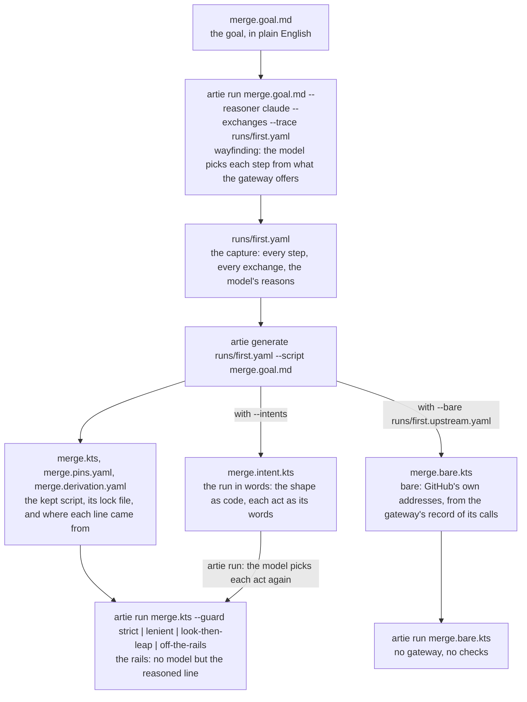

# ARTIE

ARTIE is a generic agent for any HEART server, the way a browser is a generic client for any website. It reads
what a server answers, follows the links it offers and fills the forms it offers, and it knows nothing about any
one service. `artie` is its command line: it runs a goal written in plain English, a script kept from such a run,
or a bare script that calls an ordinary API directly, and it writes the scripts from the runs.

This README documents every option of `artie run` and `artie generate`, with one job as the example throughout:
the merge watch in `exhibits/merge-watch/`.

## Quick start: your own scratch repository, your own run

The merge watch runs against a real GitHub repository, through a HEART gateway on your own machine. Nothing here
touches a repository you don't name. The script below sets it all up, start to finish, for one person, and then
walks the whole way down: the goal in plain English, the run that finds the way, the scripts generated from that
run, and those scripts run in turn.

1. **A scratch repository of your own**, say `you/heart-github-test`, and a fine-grained token for that
   repository alone, with Contents, Issues and Pull requests read and write. The token goes in
   `~/.artie/credentials`; no script ever holds it.
2. **GitHub's OpenAPI description**, which the gateway reads to learn GitHub's endpoints. It is MIT licensed,
   from `github/rest-api-description`.
3. **A certificate for the gateway**, self-signed for `localhost`, and a trust store for `artie` that holds it.
4. **The gateway**, built and started on port 8392, forwarding each caller's own token to GitHub.
5. **`artie`**, built and on the PATH.
6. **The stage**: a base branch `deps-main` holding `deps.txt`, and two pull requests opened the way Dependabot
   would open them, labelled `dependencies`: one that can be merged, and one draft, which can't.
7. **The run**: the goal in plain English, with the model finding the way. It merges the first bump, gives the
   draft three minutes, then labels it and tells its author why. It keeps watching until you close its
   "Merge watch" issue on GitHub.
8. **The scripts**: generated from that run's trace, and run on a fresh pair of bumps each: the kept script,
   held to its lock file, and the bare script, calling GitHub directly.

Set `OWNER` to your GitHub account. Every other name is the default the exhibits use.

```bash
#!/usr/bin/env bash
set -euo pipefail
OWNER=you                                   # your GitHub account
REPO=heart-github-test                      # the scratch repository; its default branch is main
ARTIE=$HOME/repos/artie                     # this repository
export JAVA_HOME=$HOME/.sdkman/candidates/java/21.0.12-graal

# 1. The scratch repository and the token.
#    Make the repository on GitHub with one commit on main (a README is enough), and a fine-grained token
#    for it alone: Contents, Issues and Pull requests, read and write. Then keep the token here:
mkdir -p ~/.artie && chmod 700 ~/.artie
grep -q '^\[https://api.github.com\]' ~/.artie/credentials 2>/dev/null || {
  read -rsp 'GitHub token: ' TOKEN; echo
  printf '[https://api.github.com]\nbearer = %s\n' "$TOKEN" >> ~/.artie/credentials
  chmod 600 ~/.artie/credentials; unset TOKEN
}
#    The model key, for --reasoner claude, goes in the same file under [https://api.anthropic.com],
#    or in ANTHROPIC_API_KEY.

# 2. GitHub's OpenAPI description, for the gateway.
mkdir -p ~/.cache/artie/ghdesc
[ -f ~/.cache/artie/ghdesc/api.github.com.json ] || curl -sSL -o ~/.cache/artie/ghdesc/api.github.com.json \
  https://raw.githubusercontent.com/github/rest-api-description/main/descriptions/api.github.com/api.github.com.json

# 3. A certificate for the gateway, and a trust store for artie.
D=~/.cache/artie/tls; mkdir -p $D; chmod 700 $D
[ -f $D/password ] || { openssl rand -hex 16 > $D/password; chmod 600 $D/password; }
P=$(cat $D/password); KT=$JAVA_HOME/bin/keytool
[ -f $D/gateway.p12 ] || {
  $KT -genkeypair -alias gateway -keyalg EC -groupname secp256r1 -dname CN=localhost \
      -ext SAN=dns:localhost,ip:127.0.0.1 -validity 365 -storetype PKCS12 \
      -keystore $D/gateway.p12 -storepass "$P" -keypass "$P"
  $KT -exportcert -rfc -alias gateway -keystore $D/gateway.p12 -storepass "$P" -file $D/gateway.pem
  cp $JAVA_HOME/lib/security/cacerts $D/trust.p12; chmod 600 $D/trust.p12
  $KT -importcert -noprompt -alias artie-gateway -file $D/gateway.pem -keystore $D/trust.p12 -storepass changeit
}

# 4. The gateway: built, then started in the background on https://localhost:8392.
cd $ARTIE/heart && ./gradlew -q :heart-gateway:installDist
cd $ARTIE/heart/heart-gateway
UPSTREAM_URL=https://api.github.com \
UPSTREAM_SPEC=$HOME/.cache/artie/ghdesc/api.github.com.json \
UPSTREAM_AUTH=caller \
GATEWAY_CONNECTOR=build/install/heart-gateway/connectors/github \
GATEWAY_RECORD=$HOME/.cache/artie/runs/upstream.record.yaml \
GATEWAY_TLS_KEYSTORE=$D/gateway.p12 GATEWAY_TLS_PASSWORD="$P" PORT=8392 \
  nohup build/install/heart-gateway/bin/heart-gateway > ~/.cache/artie/gateway.log 2>&1 &
for i in $(seq 1 30); do curl -sk https://localhost:8392/ > /dev/null && break; sleep 1; done

# 5. artie: built and on the PATH, trusting the gateway's certificate.
cd $ARTIE/client && ./gradlew -q :artie-cli:installDist
. scripts/.env
export JAVA_OPTS="-Djavax.net.ssl.trustStore=$D/trust.p12 -Djavax.net.ssl.trustStorePassword=changeit"

# 6. The stage: deps-main with deps.txt, one bump that can be merged, and one draft that can't.
cd $ARTIE/exhibits/dependabot-sim
artie run setup.kts owner=$OWNER repo=$REPO
artie run bump.kts owner=$OWNER repo=$REPO to=1.0.1 label=dependencies
artie run bump.kts owner=$OWNER repo=$REPO to=1.0.1 label=dependencies file=deps-draft.txt draft=true

# 7. The run: the goal, in plain English, with the model finding the way.
#    It merges the first bump once GitHub says it can be, gives the draft 3 minutes, then labels it
#    watch-told and tells its author why. To stop it, close the "Merge watch" issue it opened.
cd $ARTIE/exhibits/merge-watch
UP0=$(wc -l < ~/.cache/artie/runs/upstream.record.yaml)
artie run merge.goal.md owner=$OWNER repo=$REPO --reasoner claude --rung L2 --exchanges --trace runs/first.yaml
tail -n +$((UP0+1)) ~/.cache/artie/runs/upstream.record.yaml > runs/first.upstream.yaml   # the gateway's calls to GitHub

# 8. The scripts, generated from that run, and run on a fresh pair of bumps each.
artie generate runs/first.yaml --script merge.goal.md --out merge.kts
artie generate runs/first.yaml --script merge.goal.md --intents --out merge.intent.kts
artie generate runs/first.yaml --bare runs/first.upstream.yaml --out merge.bare.kts
(cd ../dependabot-sim && artie run bump.kts owner=$OWNER repo=$REPO from=1.0.1 to=1.0.2 label=dependencies \
  && artie run bump.kts owner=$OWNER repo=$REPO from=1.0.1 to=1.0.2 label=dependencies file=deps-draft.txt draft=true)
artie run merge.kts owner=$OWNER repo=$REPO --reasoner claude --guard strict --trace runs/kept.yaml
(cd ../dependabot-sim && artie run bump.kts owner=$OWNER repo=$REPO from=1.0.2 to=1.0.3 label=dependencies \
  && artie run bump.kts owner=$OWNER repo=$REPO from=1.0.2 to=1.0.3 label=dependencies file=deps-draft.txt draft=true)
artie run merge.bare.kts owner=$OWNER repo=$REPO --reasoner claude --trace runs/bare.yaml
```

To stop the gateway: `pkill -f heart-gateway/lib/heart-gateway`.

### The whole way down, in one picture



```mermaid
sequenceDiagram
  participant P as Person
  participant A as artie
  participant M as Model
  participant G as HEART gateway (localhost:8392)
  participant H as GitHub (api.github.com)
  P->>A: artie run merge.goal.md owner=… --reasoner claude --trace runs/first.yaml
  A->>G: GET / (the bookmark)
  G-->>A: the links and forms offered now
  A->>M: a goal line, the state, the offers, the links
  M-->>A: select: act github:repos-get {owner, repo}
  A->>G: GET /repos/{owner}/{repo}
  G->>H: GET /repos/{owner}/{repo} (the caller's token, If-None-Match)
  H-->>G: 200, or 304 from the gateway's copy
  G-->>A: the repository, its forms, an ETag
  Note over A,M: each step the same way: the model picks from what is offered, the server answers
  A->>G: PUT …/pulls/1781/actions/merge, If-Match: "…", {merge_method: squash}
  G->>H: PUT …/pulls/1781/merge {merge_method, sha}
  H-->>G: 200 merged
  G-->>A: 200, a new ETag
  Note over A,G: the draft never offers merge; after 3 minutes the wait gives up with the gateway's reason
  A->>M: the reasoned line, with that reason
  M-->>A: select: act github:comment {body: "Hi @…, this wasn't merged because it's still a draft…"}
  A->>G: POST …/pulls/1782/actions/comment
  A->>A: runs/first.yaml: every step, exchange and reason
  P->>A: artie generate runs/first.yaml --script merge.goal.md --out merge.kts
  A-->>P: merge.kts, merge.pins.yaml, merge.derivation.yaml
  P->>A: artie run merge.kts owner=… --reasoner claude --guard strict
  Note over A,G: the same acts with no model but the note; each form checked against its pin before it is sent
```

### What you will see

Everything below is real output from these commands on 2026-10-29, against `JogoShugh/heart-github-test` through
the gateway on this machine. The stage there was already at `left-pad 1.0.8`, so the fresh bump is 1.0.9 and the
draft bumps a second file, `deps-draft.txt`, to 1.0.1; the scratch repository also held a few dozen older
pull requests the watch had already told, which it leaves. Tokens are written `<token>`, as artie writes them.
The generated files name their sources by absolute path; those are shortened here to the paths the script uses.

<details>
<summary><b>Step 6</b>: the stage. <code>setup.kts</code> finds everything in place; each <code>bump.kts</code> opens one pull request in 6 calls.</summary>

```
$ artie run setup.kts owner=JogoShugh repo=heart-github-test
1 send GET https://api.github.com/repos/JogoShugh/heart-github-test/branches/deps-main: done
2 send GET https://api.github.com/repos/JogoShugh/heart-github-test/contents/deps.txt?ref=deps-main: done
3 send GET https://api.github.com/repos/JogoShugh/heart-github-test/labels/dependabot: done
4 send GET https://api.github.com/repos/JogoShugh/heart-github-test/labels/dependabot-actions: done
5 send GET https://api.github.com/repos/JogoShugh/heart-github-test/labels/hold: done
finished, 5 steps

$ artie run bump.kts owner=JogoShugh repo=heart-github-test from=1.0.8 to=1.0.9 label=dependencies
1 send GET https://api.github.com/repos/JogoShugh/heart-github-test/branches/deps-main: done
2 send POST https://api.github.com/repos/JogoShugh/heart-github-test/git/refs: done
3 send GET https://api.github.com/repos/JogoShugh/heart-github-test/contents/deps.txt?ref=deps/left-pad-1.0.9-1029-221447: done
4 send PUT https://api.github.com/repos/JogoShugh/heart-github-test/contents/deps.txt: done
5 send POST https://api.github.com/repos/JogoShugh/heart-github-test/pulls: done
6 send POST https://api.github.com/repos/JogoShugh/heart-github-test/issues/1781/labels: done
finished, 6 steps

$ artie run bump.kts owner=JogoShugh repo=heart-github-test to=1.0.1 label=dependencies file=deps-draft.txt draft=true
1 send GET https://api.github.com/repos/JogoShugh/heart-github-test/branches/deps-main: done
2 send POST https://api.github.com/repos/JogoShugh/heart-github-test/git/refs: done
3 send GET https://api.github.com/repos/JogoShugh/heart-github-test/contents/deps-draft.txt?ref=deps/left-pad-1.0.1-1029-221454: refused
4 send PUT https://api.github.com/repos/JogoShugh/heart-github-test/contents/deps-draft.txt: done
5 send POST https://api.github.com/repos/JogoShugh/heart-github-test/pulls: done
6 send POST https://api.github.com/repos/JogoShugh/heart-github-test/issues/1782/labels: done
finished, 6 steps
```

The refused `GET` on the draft's file is expected: the file didn't exist yet, so the script creates it. Pull
request 1781 is the fresh bump, 1782 the draft.
</details>

<details>
<summary><b>Before step 7</b>: how artie reads the goal, with nothing sent (<code>--plan-only</code>).</summary>

```
$ artie run merge.goal.md --plan-only
start https://localhost:8392/
inputs owner, repo, label, hold, told
context: Merge dependency bumps once they can be merged. Keep watching until the watch's issue is closed.
line 13: In {owner}/{repo}
line 14:   Open an issue titled "Merge watch", saying "Close this issue to stop the watch." (as watch)
line 15:   whenever: a pull request labelled {label} changes (as pr)
line 16:     if: it's labelled {hold}, then: leave it, and say so once.
line 17:     if: it's labelled {told}, then: leave it.
line 18:     once: it can be merged, then: merge it by squashing.
line 19:       give up after 3 minutes
line 20:       otherwise: label it {told}, then tell its author in one friendly sentence why it wasn't merged and what to do next.
line 21: until: someone closes {watch}
a goal in steps: 7 steps, nothing sent
```
</details>

<details>
<summary><b>Step 7</b>: the goal run. 269 steps in 4 minutes, 13 model calls; the fresh bump merged at step 14, the draft told at step 210.</summary>

The first look, the merge, and the give-up. The 185 steps left out are the watch looking again every few
seconds: the list read, each pull request read again (mostly answered `304 Not Modified`), the told ones left.

```
$ artie run merge.goal.md owner=JogoShugh repo=heart-github-test --reasoner claude --rung L2 --exchanges --trace runs/first.yaml
1 enter https://localhost:8392/: done
2 get repository JogoShugh/heart-github-test: done
3 Open an issue titled "Merge watch" with the body: Close this issue to stop the watch.: new resource
4 return to https://localhost:8392/repos/JogoShugh/heart-github-test: done
5 return to https://localhost:8392/: done
6 list pull requests of JogoShugh/heart-github-test filtered by label dependencies: done
7 return to https://localhost:8392/: done
8 return to https://localhost:8392/: done
9 act github:pulls-list, owner JogoShugh, repo heart-github-test, labels dependencies: done
10 follow item, titled Bump left-pad from 1.0.0 to 1.0.1 (1029-221454): done
11 return to https://localhost:8392/repos/JogoShugh/heart-github-test/pulls/1782: done
12 return to https://localhost:8392/repos/JogoShugh/heart-github-test/pulls?labels=dependencies: done
13 follow item, titled Bump left-pad from 1.0.8 to 1.0.9 (1029-221447): done
14 merge it by squashing: done
15 return to https://localhost:8392/repos/JogoShugh/heart-github-test/pulls/1781: done
16 return to https://localhost:8392/repos/JogoShugh/heart-github-test/pulls/1781: done
17 return to https://localhost:8392/repos/JogoShugh/heart-github-test/pulls?labels=dependencies: done
18 follow item, titled Bump left-pad from 1.0.7 to 1.0.8 (1029-220330): done
19 return to https://localhost:8392/repos/JogoShugh/heart-github-test/pulls/1780: done
20 return to https://localhost:8392/repos/JogoShugh/heart-github-test/pulls?labels=dependencies: done
21 follow item, titled Bump left-pad from 1.0.0 to 99.1.0 (1028-075217): done
note: Left https://localhost:8392/repos/JogoShugh/heart-github-test/pulls/889: leave it.
…
207 act github:pulls-list, owner JogoShugh, repo heart-github-test, labels dependencies: done
208 follow item, titled Bump left-pad from 1.0.0 to 1.0.1 (1029-221454): done
209 label it watch-told: done
210 tell its author in one friendly sentence why it wasn't merged and what to do next. The wait gave up, and the server says why: A draft can't be merged; mark it ready for review first.: new resource
211 return to https://localhost:8392/repos/JogoShugh/heart-github-test/pulls/1782: done
212 return to https://localhost:8392/repos/JogoShugh/heart-github-test/pulls?labels=dependencies: done
213 follow item, titled Bump left-pad from 1.0.7 to 1.0.8 (1029-220330): done
214 label it watch-told: done
215 tell its author in one friendly sentence why it wasn't merged and what to do next. The wait gave up, and the server says why: The branch is behind its base; update it first.: new resource
216 return to https://localhost:8392/repos/JogoShugh/heart-github-test/pulls/1780: done
…
268 return to https://localhost:8392/repos/JogoShugh/heart-github-test/issues/1783: done
269 return to https://localhost:8392/: done
finished, 269 steps
```

Pull request 1780 was a bump from an earlier run that nobody had watched; by now it was one commit behind
`deps-main`, so the gateway withheld merge on it too, and the watch told its author with the gateway's reason.
</details>

<details>
<summary><b>The trace</b>, <code>runs/first.yaml</code>: its header, with every reason the model gave.</summary>

The trace is a YAML stream: one document for the run, then one per step (79,966 lines here, with every
exchange kept by `--exchanges`). The run's document holds the inputs, the script the goal amounted to, the model's
usage, and its moves, each decision with the reason it gave:

```yaml
run:
  inputs:
    owner: { value: JogoShugh, given: given, question: Whose repository? }
    repo: { value: heart-github-test, given: given, default: heart-github-test, question: Which repository? }
    label: { value: dependencies, given: default, default: dependencies, question: Which label marks a dependency bump? }
    hold: { value: hold, given: default, default: hold, question: Which label means a person objects? }
    told: { value: watch-told, given: default, default: watch-told, question: Which label marks a pull request the watch has told why? }
  moves:
    - 'why: Reach the repository resource from which the sub-steps start.'
    - 'get repository JogoShugh/heart-github-test: acted github:repos-get, done, at https://localhost:8392/repos/JogoShugh/heart-github-test'
    - 'why: The repository is held, so the step that reaches it is complete and the sub-steps can start from here.'
    - 'done: In JogoShugh/heart-github-test'
    - 'why: The repository offers github:open-issue, so open the watch issue with the given title and body.'
    - 'Open an issue titled "Merge watch" with the body: Close this issue to stop the watch.: acted github:open-issue, new resource, at https://localhost:8392/repos/JogoShugh/heart-github-test/issues/1783'
    - 'why: The watch issue "Merge watch" was created with the requested body, so the step is complete.'
    - 'done: Open an issue titled "Merge watch", saying "Close this issue to stop the watch."'
    - 'why: The repository offers no link to pull requests, so return to the start to find a form listing pull requests filtered by label.'
    - back to the start, at https://localhost:8392/
    - 'why: github:pulls-list lists pull requests and can filter by labels; narrow it to the dependencies label in the repository.'
    - 'list pull requests of JogoShugh/heart-github-test filtered by label dependencies: decided github:pulls-list, at https://localhost:8392/'
    - 'why: The held pull request embeds github:labels containing dependencies, so check that it matches the label.'
    - 'whenever: a pull request labelled dependencies changes: decided the check {"github:labels":["dependencies"]}, at https://localhost:8392/repos/JogoShugh/heart-github-test/pulls/1782'
    - 'why: The condition is whether this pull request is labelled hold, so check that its labels include hold.'
    - 'if: it''s labelled hold: decided the check {"github:labels":["hold"]}, at https://localhost:8392/repos/JogoShugh/heart-github-test/pulls/1782'
    - 'why: The condition is whether this pull request is labelled watch-told, so check that its labels include watch-told.'
    - 'if: it''s labelled watch-told: decided the check {"github:labels":["watch-told"]}, at https://localhost:8392/repos/JogoShugh/heart-github-test/pulls/1782'
    - 'why: The pull request offers no merge form yet (draft, blocked), so wait until github:merge is offered.'
    - 'once: waits for github:merge'
    - 'why: github:merge is now offered on the held pull request, so merge it by squashing.'
    - 'merge it by squashing: decided github:merge, at https://localhost:8392/repos/JogoShugh/heart-github-test/pulls/1781'
    - 'why: The merge was acted and the held pull request shows merged: true, so the step is complete.'
    - 'why: The watch ends once the watch issue is closed, so check that its state is closed.'
    - 'until: someone closes https://localhost:8392/repos/JogoShugh/heart-github-test/issues/1783: decided the check {"state":"closed"}, at https://localhost:8392/repos/JogoShugh/heart-github-test/issues/1783'
    - 'otherwise: asked the reasoner, as the step is marked reasoned: label it watch-told'
    - 'otherwise: asked the reasoner, as the step is marked reasoned: tell its author in one friendly sentence why it wasn''t merged and what to do next. The wait gave up, and the server says why: A draft can''t be merged; mark it ready for review first.'
    - 'otherwise: asked the reasoner, as the step is marked reasoned: label it watch-told'
    - 'otherwise: asked the reasoner, as the step is marked reasoned: tell its author in one friendly sentence why it wasn''t merged and what to do next. The wait gave up, and the server says why: The branch is behind its base; update it first.'
    - 'watched: Whenever a pull request labelled dependencies changes, until someone closes https://localhost:8392/repos/JogoShugh/heart-github-test/issues/1783'
  usage:
    calls: 13
    input: 26765
    output: 2247
    cache_read: 13570
    cache_write: 8476
```

Every reason names what the server offered: "the repository offers github:open-issue", "github:merge is now
offered". The model chose among controls it was shown; it never built an address.
</details>

<details>
<summary><b>The trace</b>: one step, the merge, with what the model chose and the two exchanges it took.</summary>

Each step document records the words it served, what was chosen, the guard that held it (the form's integrity,
the set it came in, the version sent as `If-Match`), and each request and answer. The merge: one conditional
read, answered `304` because the pull request hadn't changed since the last look, then the act.

```yaml
at: '2026-10-30T02:15:40.108977Z'
ms: 7766
mode: intent
say: merge it by squashing
params:
  relation: github:merge
  merge_method: squash
chose:
  kind: form
  relation: github:merge
  title: Merge
  method: PUT
  target: /repos/{owner}/{repo}/pulls/{pull_number}/actions/merge
  address: https://localhost:8392/repos/JogoShugh/heart-github-test/pulls/1781/actions/merge
  picked: relation
  not sent:
    - commit_message
    - commit_title
guard:
  rung: L2
  set:
    href: https://localhost:8392/affordance-sets/6c989d4c275d33e1
    integrity: sha256-bJidTCddM+G3kQNm0LnzbxnwrQUVVCGA8+EbU8vwQUM=
  form: sha256-CY/mjcpRO2grR/xbdjTqaUXZFQaG/Q9F8YHBJMIkiIk=
  schema:
    href: https://localhost:8392/schemas/0f68e71ca6a8837d
    integrity: sha256-D2jnHKaog30eN9l15vAwZrWapDF8CrLyMG7Tzd7mK7c=
  if-match: '"seq-0.hsf.L2.bfd4b31a17a3ed5e"'
exchanges:
  - at: '2026-10-30T02:15:40.109191Z'
    ms: 1030
    request:
      method: GET
      url: https://localhost:8392/repos/JogoShugh/heart-github-test/pulls/1781
      headers:
        Accept: application/hal+json
        Accept-Profile: <https://w3id.org/heart-rise/hal-schema-forms>
        Prefer: forms=link, schema=link
        Cache-Control: no-cache
        If-None-Match: '"seq-0.hsf.L2.bfd4b31a17a3ed5e"'
        Authorization: <token>
        User-Agent: ARTIE/0.5
    response:
      status: 304
      headers:
        cache-control: no-cache
        etag: '"seq-0.hsf.L2.bfd4b31a17a3ed5e"'
        link: <https://w3id.org/heart-rise/hal-schema-forms>; rel="profile", <https://w3id.org/heart-rise>; rel="profile"
        vary: Accept, Prefer, Accept-Profile
  - at: '2026-10-30T02:15:42.325293Z'
    ms: 5547
    request:
      method: PUT
      url: https://localhost:8392/repos/JogoShugh/heart-github-test/pulls/1781/actions/merge
      headers:
        Accept: application/hal+json
        Content-Type: application/json
        If-Match: '"seq-0.hsf.L2.bfd4b31a17a3ed5e"'
        Authorization: <token>
        User-Agent: ARTIE/0.5
      body:
        merge_method: squash
    response:
      status: 200
      headers:
        content-location: /repos/JogoShugh/heart-github-test/pulls/1781
        content-type: application/hal+json
        etag: '"seq-0.hsf.L2.fe903a075f9320b6"'
      body:
        number: 1781
        state: closed
        merged: true
        …
```

What the model was asked is in the step too, under `model`: the pull request's state, the forms offered on it
(`github:close`, `github:comment`, `github:edit`, `github:label`, `github:merge`, `github:request-review`,
`github:update-branch`, each with its schema), its links, and the words "merge it by squashing". Its answer:

```json
{"action": "act", "affordance": "github:merge", "fields": {"merge_method": "squash"}}
```
</details>

<details>
<summary><b>The trace</b>: the reasoned line, where the model writes the note.</summary>

When the draft's wait gave up, the gateway's reason for withholding merge went to the model with the goal's
words. It chose the comment form and wrote the sentence; the pull request was labelled first, by the same kind
of step.

```yaml
say: label it watch-told
chose: github:label
body:
  labels:
    - watch-told
status: 200
---
at: '2026-10-30T02:18:45.899310Z'
ms: 7174
mode: intent
say: 'tell its author in one friendly sentence why it wasn''t merged and what to do next. The wait gave up, and the server says why: A draft can''t be merged; mark it ready for review first.'
params:
  relation: github:comment
  body: Hi @JogoShugh, this wasn't merged because it's still a draft, and a draft can't be merged, so please mark it ready for review first and then it can go in!
chose:
  kind: form
  relation: github:comment
  title: Comment
  method: POST
  target: /repos/{owner}/{repo}/pulls/{pull_number}/actions/comment
  address: https://localhost:8392/repos/JogoShugh/heart-github-test/pulls/1782/actions/comment
  picked: relation
```

On GitHub, pull request 1782 now carries the labels `dependencies, watch-told` and that one comment.
</details>

<details>
<summary><b>Step 8</b>: <code>artie generate</code>, three scripts from one trace.</summary>

```
$ artie generate runs/first.yaml --script merge.goal.md --out merge.kts
wrote merge.kts: 0 values to review
wrote merge.pins.yaml: 6 forms and 2 links pinned
wrote merge.derivation.yaml: 8 derivations

$ artie generate runs/first.yaml --script merge.goal.md --intents --out merge.intent.kts
wrote merge.intent.kts: 0 values to review, 2 reason steps kept
wrote merge.intent.pins.yaml: 6 forms and 2 links pinned
wrote merge.intent.derivation.yaml: 5 derivations

$ artie generate runs/first.yaml --bare runs/first.upstream.yaml --out merge.bare.kts
wrote merge.bare.kts: the watch's words over 7 calls to the service, at fixed addresses
```

`--bare` needs a run in which every line of the goal made a call. A first attempt from a run with only a fresh
bump was refused: `can't bring the watch down to calls: the run made no call for "label it …"`. That is why the
stage opens a draft too.
</details>

<details>
<summary><code>merge.kts</code>: the kept script. Every choice the run made, written down; the model only at the reasoned line.</summary>

```kotlin
// Generated by artie generate from runs/first.yaml, the run of merge.goal.md.
// Every selection as that run made it, nested as it nested; an act it left to the model stays in words.
// What it was offered is pinned in merge.pins.yaml, held to before every act.
// 2 acts in the watch call the model each time one is reached: artie run needs --reasoner.
//   artie run merge.kts owner=JogoShugh repo=heart-github-test --reasoner claude
import kotlin.time.Duration.Companion.minutes
val owner by input(question = "Whose repository?")
val repo by input(default = "heart-github-test", question = "Which repository?")
val label by input(default = "dependencies", question = "Which label marks a dependency bump?")
val hold by input(default = "hold", question = "Which label means a person objects?")
val told by input(default = "watch-told", question = "Which label marks a pull request the watch has told why?")

heart("https://localhost:8392/") {
    act("github:repos-get", inferred = "get repository $owner/$repo", fromIntent = "In ${owner}/${repo}", fields = {
        "owner" to owner
        "repo" to repo
    }) {
        act("github:open-issue", intent = """Open an issue titled "Merge watch", saying "Close this issue to stop the watch."""", fields = {
            "title" to "Merge watch"
            "body" to "Close this issue to stop the watch."
        }) {
            keepAs("watch")
        }
    }
    watch(until = { at("watch") { "state" eq "closed" } }) {
        act("github:pulls-list", "owner" to owner, "repo" to repo, "labels" to label, inferred = "list pull requests of ${owner}/${repo} filtered by label ${label}", fromIntent = "a pull request labelled ${label} changes") {
            whenever {
                has { "github:labels" has label }
                leaveWhere("leave it, and say so once.") { "github:labels" has hold }
                leaveWhere("leave it.") { "github:labels" has told }
                once("github:merge", giveUp = 3.minutes, otherwise = { why ->
                    act(intent = "label it ${told}")
                    act(intent = "tell its author in one friendly sentence why it wasn't merged and what to do next. The wait gave up, and the server says why: ${why ?: "no reason given"}")
                }) {
                    act("github:merge", "merge_method" to "squash", intent = "merge it by squashing.") {}
                }
            }
        }
    }
}
```

`merge.intent.kts` is the same shape with the relations taken out: `act(inferred = "get repository $owner/$repo", …)`,
`act(intent = "merge it by squashing.") {}`, so the model picks each act again on every run.
</details>

<details>
<summary><code>merge.pins.yaml</code>: the lock file. The integrity of each form the run was offered, and the sets it came in.</summary>

```yaml
# What merge.kts was recorded against, from runs/first.yaml. artie run holds the script to it before every act:
# --guard lenient (the default) refuses a form no longer offered, or whose integrity changed; --guard strict
# also refuses one offered in a set not recorded for it.
rung: L2
digest: sha256-iBmq8RVpA5my4yokZ0mDyF5Q/0BWxp2xdPGJuiI4POY=
forms:
  github:repos-get:
    integrity: sha256-Yze4SmWrjszXwXcvmOltk7ILgcC0YZsTYYqUicgv1Go=
    method: GET
    sets: []
  github:open-issue:
    integrity: sha256-7nm0xX/JP+BNMWY1bYbDj/IscGf8ariWZljqVz35xqI=
    method: POST
    sets:
      - sha256-t8352b0vFug59dPyOrG80DIEf+lWTm4RO0sUfhLHR+Y=
  github:pulls-list:
    integrity: sha256-FY1PFQTdShpl5pV0PsmaXXnhMjITXQaoOK86e9QDgpk=
    method: GET
    sets: []
  github:merge:
    integrity: sha256-CY/mjcpRO2grR/xbdjTqaUXZFQaG/Q9F8YHBJMIkiIk=
    method: PUT
    sets:
      - sha256-bJidTCddM+G3kQNm0LnzbxnwrQUVVCGA8+EbU8vwQUM=
  github:label:
    integrity: sha256-E6Dht1OvjHWMm1Q2FD4+08H3pne+aT5TyvC+yzhrtHc=
    method: POST
    sets:
      - sha256-MOjaUYZkgsvrFZq7fdqPbDwscpbyRQiSAaEB6Z67HCg=
      - sha256-SJnR5lTVbJYILhkKPxP0E6Kg1rM4U8RmgXrpRH2ks7k=
  github:comment:
    integrity: sha256-hBIa40tU8EJokuebe8npx54kItbP3z/jGbJW8FsL26c=
    method: POST
    sets:
      - sha256-MOjaUYZkgsvrFZq7fdqPbDwscpbyRQiSAaEB6Z67HCg=
      - sha256-SJnR5lTVbJYILhkKPxP0E6Kg1rM4U8RmgXrpRH2ks7k=
links:
  item: ''
  next: ''
```

The `digest` is the gateway's declared list of every form it can offer; `--guard look-then-leap` compares it once
at the start. `github:merge`'s integrity here is the one in the trace's `guard` above.
</details>

<details>
<summary><code>merge.derivation.yaml</code>: where each line of the script came from.</summary>

```yaml
# How merge.kts was derived from runs/first.yaml, the run of merge.goal.md: each derivation, numbered
# in the order merge.kts first shows it, with the rule of spec/PLAN-SCRIPT-GENERATOR.md that bound it, and where it
# stands in both scripts (line and column, from 1); rows: where each step of the run begins in both.
script: 'merge.kts'
source: 'merge.goal.md'
capture: 'runs/first.yaml'
rows:
  - {at: 'inputs', source: null, generated: 7}
  - {at: '1', source: null, generated: 13}
  - {at: '2', source: 1, generated: 14}
  - {at: '3', source: 2, generated: 18}
derivations:
  - n: 1
    kind: input
    rule: '1, 2.1'
    title: 'owner, an input'
    why: 'Declared as the run''s script declared it (rule 1); each value the run took from it is sent from it (rule 2.1).'
    source:
      - {line: 1, column: 30, text: '$owner'}
    generated:
      - {line: 7, column: 1, text: 'val owner by input(question = "Whose repository?")'}
      - {line: 15, column: 20, text: 'owner'}
  …
  - n: 6
    kind: relation
    rule: '9'
    title: 'The relation each reason step chose, named'
    why: 'Where the run''s script reasoned, the reasoner chose among the forms and links offered. The generated script names the relation it chose; the lock file pins what was offered with it.'
    source:
      - {line: 1, column: 1, text: 'act'}
      - {line: 2, column: 1, text: 'act'}
    generated:
      - {line: 14, column: 9, text: '"github:repos-get"'}
      - {line: 18, column: 13, text: '"github:open-issue"'}
  - n: 7
    kind: words
    rule: '2.2'
    title: '"Merge watch", as the words wrote it'
  - n: 8
    kind: words
    rule: '2.2'
    title: '"Close this issue to stop the watch.", as the words wrote it'
```
</details>

<details>
<summary><code>merge.bare.kts</code>: the same watch as calls to GitHub at fixed addresses, from the gateway's record.</summary>

```kotlin
// Made by artie generate --bare from runs/first.yaml and runs/first.upstream.yaml (spec/ideas/bare-runs.md, "Rails"):
// the kept script's watch, its words kept, each act brought down to the call it made to the service, at a
// fixed address. No entry, no forms, no validators, no reasons for absence: where the kept script waits for a
// form, this tries the call, and the service's refusal is the only gate.
import kotlin.time.Duration.Companion.minutes

val owner by input(question = "Whose repository?")
val repo by input(default = "heart-github-test", question = "Which repository?")
val label by input(default = "dependencies", question = "Which label marks a dependency bump?")
val hold by input(default = "hold", question = "Which label means a person objects?")
val told by input(default = "watch-told", question = "Which label marks a pull request the watch has told why?")

bare {
    val watch = call("POST", "https://api.github.com/repos/${owner}/${repo}/issues", mapOf("title" to "Merge watch", "body" to "Close this issue to stop the watch."))
    watch(until = { call("GET", "https://api.github.com/repos/${owner}/${repo}/issues/${watch["number"].text}")["state"].text == "closed" }) {
        whenever(call("GET", "https://api.github.com/repos/${owner}/${repo}/issues?labels=${label}")) { item ->
            val member = call("GET", "https://api.github.com/repos/${owner}/${repo}/pulls/${item["number"].text}")
            has(member["labels"] has label)
            leaveWhere("leave it, and say so once.", member["labels"] has hold)
            leaveWhere("leave it.", member["labels"] has told)
            once("PUT", "https://api.github.com/repos/${owner}/${repo}/pulls/${member["number"].text}/merge", mapOf("merge_method" to "squash", "sha" to member["head"]["sha"].text), giveUp = 3.minutes, otherwise = { why ->
                call("POST", "https://api.github.com/repos/${owner}/${repo}/issues/${member["number"].text}/labels", mapOf("labels" to listOf("${told}")))
                call("POST", "https://api.github.com/repos/${owner}/${repo}/issues/${member["number"].text}/comments", mapOf("body" to write("tell its author in one friendly sentence why it wasn't merged and what to do next. The wait gave up, and the server says why: ${why ?: "no reason given"}")))
            })
        }
    }
}
```
</details>

<details>
<summary><b>The kept script's run</b>, <code>--guard strict</code>: 308 steps in 4 minutes, 2 model calls, both for the draft's note.</summary>

Same shape as the goal run, with no reasoning: each act is named, and checked against its pin before it is sent.

```
$ artie run merge.kts owner=JogoShugh repo=heart-github-test --reasoner claude --guard strict --trace runs/kept.yaml
1 enter https://localhost:8392/: done
2 act github:repos-get, owner JogoShugh, repo heart-github-test: done
3 act github:open-issue, title Merge watch, body Close this issue to stop the watch.: new resource
4 return to https://localhost:8392/repos/JogoShugh/heart-github-test: done
5 return to https://localhost:8392/: done
6 return to https://localhost:8392/: done
7 act github:pulls-list, owner JogoShugh, repo heart-github-test, labels dependencies: done
8 follow item, titled Bump left-pad from 1.0.1 to 1.0.2 (1029-222002): done
9 return to https://localhost:8392/repos/JogoShugh/heart-github-test/pulls/1785: done
10 return to https://localhost:8392/repos/JogoShugh/heart-github-test/pulls?labels=dependencies: done
11 follow item, titled Bump left-pad from 1.0.9 to 1.0.10 (1029-221954): done
12 return to https://localhost:8392/repos/JogoShugh/heart-github-test/pulls/1784: done
13 return to https://localhost:8392/repos/JogoShugh/heart-github-test/pulls?labels=dependencies: done
14 follow item, titled Bump left-pad from 1.0.0 to 1.0.1 (1029-221454): done
note: Left https://localhost:8392/repos/JogoShugh/heart-github-test/pulls/1782: leave it.
…
249 act github:pulls-list, owner JogoShugh, repo heart-github-test, labels dependencies: done
250 follow item, titled Bump left-pad from 1.0.1 to 1.0.2 (1029-222002): done
251 label it watch-told: done
252 tell its author in one friendly sentence why it wasn't merged and what to do next. The wait gave up, and the server says why: A draft can't be merged; mark it ready for review first.: new resource
253 return to https://localhost:8392/repos/JogoShugh/heart-github-test/pulls/1785: done
…
307 return to https://localhost:8392/repos/JogoShugh/heart-github-test/issues/1786: done
308 return to https://localhost:8392/: done
finished, 308 steps
```

The run's usage, from `runs/kept.yaml`: `calls: 2, input: 4936, output: 248`. Pull request 1782, the goal run's
draft, is left at step 14 with no model call: its `watch-told` label is the memory, on the resource itself.
</details>

<details>
<summary><b>The bare run</b>: 81 steps, 1 model call. It merged the fresh bump, and GitHub itself refused the draft every time until the wait gave up.</summary>

```
$ artie run merge.bare.kts owner=JogoShugh repo=heart-github-test --reasoner claude --trace runs/bare.yaml
1 send POST https://api.github.com/repos/JogoShugh/heart-github-test/issues: done
2 send GET https://api.github.com/repos/JogoShugh/heart-github-test/issues?labels=dependencies: done
3 send GET https://api.github.com/repos/JogoShugh/heart-github-test/pulls/1788: done
4 send PUT https://api.github.com/repos/JogoShugh/heart-github-test/pulls/1788/merge: refused
5 send GET https://api.github.com/repos/JogoShugh/heart-github-test/pulls/1787: done
6 send PUT https://api.github.com/repos/JogoShugh/heart-github-test/pulls/1787/merge: refused
7 send GET https://api.github.com/repos/JogoShugh/heart-github-test/pulls/1785: done
note: Left https://api.github.com/repos/JogoShugh/heart-github-test/issues/1785: leave it.
8 send GET https://api.github.com/repos/JogoShugh/heart-github-test/pulls/1782: done
note: Left https://api.github.com/repos/JogoShugh/heart-github-test/issues/1782: leave it.
…
32 send GET https://api.github.com/repos/JogoShugh/heart-github-test/issues/1789: done
33 send GET https://api.github.com/repos/JogoShugh/heart-github-test/issues?labels=dependencies: done
34 send GET https://api.github.com/repos/JogoShugh/heart-github-test/pulls/1788: done
35 send PUT https://api.github.com/repos/JogoShugh/heart-github-test/pulls/1788/merge: refused
36 send GET https://api.github.com/repos/JogoShugh/heart-github-test/pulls/1787: done
37 send PUT https://api.github.com/repos/JogoShugh/heart-github-test/pulls/1787/merge: done
…
72 send GET https://api.github.com/repos/JogoShugh/heart-github-test/pulls/1788: done
73 send PUT https://api.github.com/repos/JogoShugh/heart-github-test/pulls/1788/merge: refused
74 send POST https://api.github.com/repos/JogoShugh/heart-github-test/issues/1788/labels: done
75 send POST https://api.github.com/repos/JogoShugh/heart-github-test/issues/1788/comments: done
76 send GET https://api.github.com/repos/JogoShugh/heart-github-test/issues/1789: done
77 send GET https://api.github.com/repos/JogoShugh/heart-github-test/issues?labels=dependencies: done
78 send GET https://api.github.com/repos/JogoShugh/heart-github-test/pulls/1788: done
79 send GET https://api.github.com/repos/JogoShugh/heart-github-test/issues/1789: done
80 send GET https://api.github.com/repos/JogoShugh/heart-github-test/issues?labels=dependencies: done
81 send GET https://api.github.com/repos/JogoShugh/heart-github-test/issues/1789: done
finished, 81 steps
```

Bare has no forms to wait for, so `once` tries the merge on every look and GitHub refuses it: the draft at every
look, and the fresh bump once, at step 6, seconds after it was opened; the next look merged it at step 37. Usage from
`runs/bare.yaml`: `calls: 1, input: 236, output: 140`, the note alone.
</details>

<details>
<summary><b>The three notes</b> the drafts got, one per run, each written by the model from the server's reason.</summary>

| Run | Pull request | Comment |
|---|---|---|
| The goal | 1782 | Hi @JogoShugh, this wasn't merged because it's still a draft, and a draft can't be merged, so please mark it ready for review first and then it can go in! |
| The kept script | 1785 | Hi @JogoShugh, this pull request wasn't merged because it's still a draft, so please mark it ready for review and then it can be merged. |
| Bare | 1788 | Hi! Your pull request wasn't merged because it's still marked as a draft, so please mark it as ready for review and then we can try merging again. |

Each one carries the labels `dependencies, watch-told` afterwards, so no later watch tells it again.
</details>

What to expect, then: the goal run merges the fresh bump within a minute or two and tells the draft's author
after its three-minute wait, at about 13 model calls; the kept script does the same at 2 calls, bare at 1. Open
another bump while a watch runs (`artie run bump.kts owner=$OWNER repo=$REPO from=1.0.3 to=1.0.4 label=dependencies`)
and watch it merged. Close the "Merge watch" issue, and the run ends at its next look.

## The modules

| Module | What it is |
|---|---|
| `heart-script` | The scripting language: `heart { act(…) follow(…) }`, waits and watches, facts, and the bare vocabulary |
| `artie` | The client: HTTP and CoAP bindings, caching, validators, credentials, the reasoner, the guards |
| `artie-cli` | The `artie` command: `artie run` and `artie generate` |
| `heart-script-host` | Compiles and runs `.kts` scripts |
| `heart-script-test` | Expectations a script can state about a run, for tests written as scripts |

## Build and set up

ARTIE builds with Java 21 and runs on Java 21 or later.

```sh
cd client
JAVA_HOME=$HOME/.sdkman/candidates/java/21.0.12-graal ./gradlew :artie-cli:installDist
. scripts/.env          # puts artie on the PATH and reads the token and model key from where they live
```

`scripts/.env` holds no secret itself. It reads each one, when sourced, from where it already lives.

**Credentials** are by origin, never in a script. ARTIE looks in three places, in order:

1. Environment variables named by origin: `https://localhost:8392` reads `ARTIE_TOKEN_LOCALHOST_8392` (a bearer
   token), or `ARTIE_USER_…` and `ARTIE_PASSWORD_…` (Basic). The scheme is not in the name.
2. `~/.artie/credentials`, one section per origin, readable by its owner only:
   ```ini
   [https://localhost:8392]
   bearer = …
   ```
3. Vault, when `ARTIE_VAULT_ADDR` is set.

**A local gateway over HTTPS** needs its certificate trusted:

```sh
export JAVA_OPTS="-Djavax.net.ssl.trustStore=$HOME/.cache/artie/tls/trust.p12 -Djavax.net.ssl.trustStorePassword=changeit"
```

Without it, a run against `https://localhost:8392` stops with "PKIX path building failed".

**The model**, for `--reasoner claude`, reads `ANTHROPIC_API_KEY`, or else the bearer entry for
`https://api.anthropic.com` in the credentials, as for any origin.

## From plain text to rails

One job can be run at five levels, each made from the one before by `artie generate`, from a single recorded run.
Going down, the model does less and the script says more; what stays the same is the person's words.

| Level | File | Who decides each step | Model on every run |
|---|---|---|---|
| 1. The goal, in plain text | `merge.goal.md` | The model, reading each line | Every step |
| 2. The run in words | `merge.intent.kts` | The model, picking from what is offered; the shape is code | Every act |
| 3. Relations, with their words | `merge.kts` | The script; held to its lock file | Only a `reasoned` line |
| 4. The same script, at a level of care | `merge.kts --guard …` | The script, trusting more or less | Only a `reasoned` line |
| 5. Bare | `merge.bare.kts` | The script, at fixed addresses, no checks | Only a `reasoned` line |

The same act at each level:

```kotlin
// 1. merge.goal.md
//    - Once it can be merged, merge it by squashing.

// 2. merge.intent.kts
act(intent = "merge it by squashing.") {}

// 3. merge.kts
act("github:merge", "merge_method" to "squash", intent = "merge it by squashing.") {}

// 5. merge.bare.kts
once("PUT", "https://api.github.com/repos/${owner}/${repo}/pulls/${member["number"].text}/merge",
    mapOf("merge_method" to "squash", "sha" to member["head"]["sha"].text), giveUp = 3.minutes, ...)
```

**Whose words.** An act's words say what it is for, and whose they are:

| An act | Carries |
|---|---|
| does one of a goal's steps | `intent = "merge it by squashing."`, the person's words |
| serves a goal line that names no act: `In {owner}/{repo}`, a Whenever, or an act on the way to a step's job | `inferred = "get the repository $owner/$repo", fromIntent = "In ${owner}/${repo}"` |
| has no goal line at all: a goal in plain prose | `inferred = "close it"` |

- `intent`: a person's words, from a line of the goal or written in a script, each input as the variable the script
  reads.
- `inferred`: words a model wrote while it ran, each input's value put back as its variable.
- `fromIntent`: the person's words that inferred words serve. It is kept for the reader, and never reasoned on alone.

With no relation, the reasoner is handed the intent, or else the inferred words.

## The merge watch, start to finish

The merge watch is one job, run every way ARTIE can run it. A HEART gateway in front of GitHub
(`heart/heart-gateway`, at `https://localhost:8392`) serves the repository; everything below is run from
`exhibits/merge-watch/`.

### 1. The goal, in plain English

`merge.goal.md`:

```markdown
---
start: https://localhost:8392/
inputs:
  owner: { question: "Whose repository?" }
  repo:  { default: heart-github-test, question: "Which repository?" }
  label: { default: dependencies, question: "Which label marks a dependency bump?" }
  hold:  { default: hold, question: "Which label means a person objects?" }
  told:  { default: watch-told, question: "Which label marks a pull request the watch has told why?" }
---

Merge dependency bumps once they can be merged. Keep watching until the watch's issue is closed.

- In {owner}/{repo}
  - Open an issue titled "Merge watch", saying "Close this issue to stop the watch." `as watch`
  - Whenever a pull request labelled {label} changes `as pr`
    - If it's labelled {hold}, leave it, and say so once.
    - If it's labelled {told}, leave it.
    - Once it can be merged, merge it by squashing.
      Or give up after 3 minutes.
      Otherwise, label it {told}, then tell its author in one friendly sentence why it wasn't merged and what to do next. `reasoned`
- Until someone closes {watch}
```

The header names the entry point and the inputs. Each `{name}` is an input. The marks in backquotes are ARTIE's:
`as watch` names what a line made, so a later line can refer to it, and `reasoned` marks a line whose words the
model writes every time.

The watch tells each pull request why once, across runs. The label `{told}` is the mark: a fact on the pull
request that any later run reads, so the next watch leaves it. A reasoned Otherwise asks the model one act at a
time, one for each part after ", then".

Check how ARTIE reads it, with nothing sent:

```sh
artie run merge.goal.md --plan-only
```
```
start https://localhost:8392/
inputs owner, repo, label, hold, told
context: Merge dependency bumps once they can be merged. Keep watching until the watch's issue is closed.
line 13: In {owner}/{repo}
line 14:   Open an issue titled "Merge watch", saying "Close this issue to stop the watch." (as watch)
line 15:   whenever: a pull request labelled {label} changes (as pr)
line 16:     if: it's labelled {hold}, then: leave it, and say so once.
line 17:     if: it's labelled {told}, then: leave it.
line 18:     once: it can be merged, then: merge it by squashing.
line 19:       give up after 3 minutes
line 20:       otherwise: label it {told}, then tell its author in one friendly sentence why it wasn't merged and what to do next.
line 21: until: someone closes {watch}
a goal in steps: 7 steps, nothing sent
```

### 2. Run the goal: wayfinding

The model reads each line and picks, from the links and forms the gateway offers at that moment, the step that
does what the line says.

```sh
artie run merge.goal.md owner=JogoShugh --reasoner claude --rung L2 --exchanges --trace runs/live-8.yaml
```

The watch runs until someone closes its issue. `--trace` keeps every step; `--exchanges` keeps each request and
answer in it, which `artie generate --bare` needs later.

### 3. Keep the run in words, then the script it amounts to

```sh
artie generate runs/live-8.yaml --script merge.goal.md --intents --out merge.intent.kts
artie generate runs/live-8.yaml --script merge.goal.md --out merge.kts
```

The first keeps the run's shape as code, each act as its words alone, for the reasoner to choose on every run:

```kotlin
act(inferred = "get the repository $owner/$repo", fromIntent = "In ${owner}/${repo}") {
    act(intent = """Open an issue titled "Merge watch", saying "Close this issue to stop the watch."""") {
        keepAs("watch")
    }
}
watch(until = { at("watch") { "state" eq "closed" } }) {
    act(inferred = "list pull requests of ${owner}/${repo} filtered by label ${label}", fromIntent = "a pull request labelled ${label} changes") {
        whenever {
            has { "github:labels" has label }
            leaveWhere("leave it, and say so once.") { "github:labels" has hold }
            leaveWhere("leave it.") { "github:labels" has told }
            once("github:merge", giveUp = 3.minutes, otherwise = { why ->
                act(intent = "label it ${told}")
                act(intent = "tell its author ...")
            }) {
                act(intent = "merge it by squashing.") {}
            }
        }
    }
}
```

The second fixes each choice the run made.

This writes three files:

- `merge.kts`: the script, with every choice the run made and no model, except for the reasoned line.
- `merge.pins.yaml`: the lock file. For each relation the script uses, it records the integrity of the form it
  was offered, its method and the sets it came in, plus the digest of every form the server declared.
- `merge.derivation.yaml`: for each line of the script, which step of the run it came from, and which rule.

The heart of `merge.kts`:

```kotlin
act("github:repos-get", "owner" to owner, "repo" to repo, inferred = "get the repository $owner/$repo", fromIntent = "In ${owner}/${repo}") {
    act("github:open-issue", intent = """Open an issue titled "Merge watch", saying "Close this issue to stop the watch."""", fields = {
        "title" to "Merge watch"
        "body" to "Close this issue to stop the watch."
    }) {
        keepAs("watch")
    }
}
watch(until = { at("watch") { "state" eq "closed" } }) {
    act("github:pulls-list", "owner" to owner, "repo" to repo, "labels" to label, inferred = "list pull requests of ${owner}/${repo} filtered by label ${label}", fromIntent = "a pull request labelled ${label} changes") {
        whenever {
            has { "github:labels" has label }
            leaveWhere("leave it, and say so once.") { "github:labels" has hold }
            leaveWhere("leave it.") { "github:labels" has told }
            once("github:merge", giveUp = 3.minutes, otherwise = { why ->
                act(intent = "label it ${told}")
                act(intent = "tell its author in one friendly sentence why it wasn't merged ... ${why ?: "no reason given"}")
            }) {
                act("github:merge", "merge_method" to "squash", intent = "merge it by squashing.") {}
            }
        }
    }
}
```

Every act carries words beside its relation: the goal's own, or the model's with the goal line they serve.

List a script's inputs without running it:

```sh
artie run merge.kts --inputs-of
```
```
owner: a question, "Whose repository?"
repo: optional, default "heart-github-test"
label: optional, default "dependencies"
hold: optional, default "hold"
told: optional, default "watch-told"
```

### 4. Run the kept script, at the level of care you choose

```sh
artie run merge.kts owner=JogoShugh --reasoner claude                           # lenient, the default
artie run merge.kts owner=JogoShugh --reasoner claude --guard strict
artie run merge.kts owner=JogoShugh --reasoner claude --guard look-then-leap    # --look used, the default
artie run merge.kts owner=JogoShugh --reasoner claude --guard look-then-leap --look everything
artie run merge.kts owner=JogoShugh --reasoner claude --guard off-the-rails
```

`--reasoner claude` is there only for the reasoned line, the note to an author. Without it, that step is
refused, and the run says where the model key goes.

See [Guards](#guards) for what each level checks.

### 5. Bring it down to bare calls

A bare script calls the service directly, at fixed addresses, with no gateway and no checks. It is generated
from a goal run kept with `--exchanges`, and the gateway's record of the calls it made to GitHub
(`GATEWAY_RECORD`):

```sh
artie generate runs/live-8.yaml --bare runs/live-8.upstream.yaml --out merge.bare.kts
artie run merge.bare.kts owner=JogoShugh --reasoner claude
```

Bare is fast, and only as safe as the service's own rules. On the scratch repository, bare merged a pull request
one commit behind its base, which GitHub calls clean. Every guard level through the gateway held it back: the
gateway's own rule withholds merge while a branch is behind.

## `artie run`

```
artie run <script> [name=value …] [options]
```

`<script>` is a goal (`.goal.md`), a kept script (`.kts`) or a bare script (`.bare.kts`), in the current folder.

### Inputs

| Option | What it does |
|---|---|
| `name=value` | Gives the input `name`. Repeat it for each one. |
| `--inputs FILE` | Reads inputs from a JSON or YAML file. Values given on the line win. |
| `--interactive` | Asks a person for each input the script still needs, and for each `ask(…)` in it. Without it, a missing input stops the run before its first request. |
| `--inputs-of` | Lists the script's inputs, and how many questions it asks inline, without running it. |
| `--plan-only` | For a goal: reads, checks and prints it, with nothing sent. |

### Where and how it reads

| Option | What it does |
|---|---|
| `--entry URL` | Starts at another entry point than the one the script or goal names: the same script against another server. |
| `--rung L0\|L1\|L2` | Which rung of HEART the client asks for. L0 gets forms and schemas inline; L1 and L2 get them by link, shared and cached. A kept script reads at the rung its lock file records. |
| `--reasoner claude` | Allows the steps that need a model: every step of a goal, and a script's reasoned lines. |
| `--remember FILE` | For a watch: keeps what it did in FILE, so that run again, it doesn't do it again (a comment already made, a "left" already said). |

### Guards

How carefully a kept script holds to its lock file, from most to least careful:

| `--guard` | What it checks |
|---|---|
| `strict` | Everything `lenient` checks, plus the whole set of forms each act came in. Anything not recorded is refused. For audited work. |
| `lenient` | The default. Before each act: that it's offered, that the body fits the form's schema, and that the form is the one pinned. Reads again after acting. A changed form it uses is refused; a change elsewhere is not. |
| `look-then-leap` | One look at the server's manifest of forms at the start. If nothing it compares has changed, the rest of the run is off the rails; otherwise lenient. It says which, in the run's notes. |
| `off-the-rails` | No pins, no schema check, no reading again; recorded addresses are fetched directly. It still sends the ETag of the last answer, a 412 stops the run, and the server still enforces its own rules. Needs no lock file. |

| Option | What it does |
|---|---|
| `--look used\|everything` | What `look-then-leap` compares. `used`, the default: each form the lock file pins, against the integrity the server lists for it. `everything`: the digest of every form the server declares, against the one the lock file kept. |
| `--validators last\|none` | What each act carries in `If-Match`. `last`, the default: the ETag of the last answer for that resource. `none`: no validator, a blind write, which a HEART server refuses unless its development switch allows it. |
| `--pins FILE` | Holds to another lock file than `NAME.pins.yaml` beside the script. |
| `--config FILE` | Reads another config than `NAME.config.yaml` beside the script. |
| `--no-repin` | Leaves the lock file as it is, whatever the config says. |

**The config file**, `NAME.config.yaml` beside the script, set by a person and never written by ARTIE. A flag on
the command line wins over it.

```yaml
guard: lenient          # strict, lenient, look-then-leap or off-the-rails
look: used              # used or everything
on-change: refuse       # refuse, or values: go past a changed form when it keeps its method and what is sent fits it
repin: never            # never, propose (say what would change), or auto (write it into the lock file)
validators: last        # last or none
```

### What the run writes

| Option | What it does |
|---|---|
| `--trace FILE` | Writes the trace to FILE instead of `runs/NAME-<time>.trace.yaml`, where every run writes one. It holds every step: what was asked, the values sent and where each came from, the answer, the guard's check, and the run's inputs. A goal run's trace also keeps the script its choices amount to. YAML. |
| `--exchanges` | Keeps each request and answer in the trace, with its `traceparent`, so the gateway's record of its upstream calls can be joined to the step. |
| `--report DIR` | Builds an HTML report of the run in DIR, from the trace (needs the report builder installed beside `artie`). |
| `--quiet` | Prints only the last line. |
| `--output json` | Prints the outcome as one JSON object. |

By default, `artie run` prints one line per step and a last line saying how the run ended, such as
`finished, 252 steps`.

### Exit codes

| Code | Meaning |
|---|---|
| 0 | Finished, or listed (`--inputs-of`, `--plan-only`) |
| 1 | A check or an expectation in the script was not met |
| 2 | Stopped before the first request: bad arguments, a missing input, no lock file for `--guard`, a rung other than the lock file's |
| 3 | Refused by the server or by the guard |
| 4 | The client failed: the network, TLS, a server error |
| 5 | The script has an error |

## `artie generate`

```
artie generate <capture.yaml> --out <script.kts> [--script <source>] [--keep-reason] [--intents] [--inputs a,b] [--report <dir>]
artie generate <capture.yaml> --bare <upstream.yaml> --out <script.bare.kts>
```

`<capture.yaml>` is a run's trace, from `artie run --trace`.

| Option | What it does |
|---|---|
| `--out FILE` | The script to write. Beside it, `NAME.pins.yaml` and `NAME.derivation.yaml`. |
| `--script FILE` | The goal or script the run ran. With a goal, the generated script follows its lines and keeps its words as each act's `intent`. |
| `--keep-reason` | Keeps each reasoned step as a reasoned step, instead of writing down the choice the model made. |
| `--intents` | Writes the run in words only: its shape as code, each act and follow as `act(intent = "…")` or `act(inferred = "…")`, for the reasoner to choose on every run. A watch's acts too; what `once` waits for stays named. |
| `--inputs a,b` | Makes the values the run sent under these fields into inputs, defaulting to what was sent. |
| `--report DIR` | Builds a derivation report in DIR: the source and the generated script side by side, each derivation numbered on both (needs `--script`). |
| `--bare FILE` | Writes a bare script instead, from the gateway's upstream record FILE: each act the call it came down to, at a fixed address. A run that watched becomes a bare watch with the same words. Needs a capture kept with `--exchanges`. |

A generated script prints what to review: `wrote merge.kts: 0 values to review` means every value came from an
input or an earlier answer. A value the model chose, with nothing to read it from, is marked `review:` in the
script.

## Further reading

- `spec/PLAN-ARTIE-SCRIPTS.md`: the scripting language and `artie run`
- `spec/PLAN-SCRIPT-GENERATOR.md`: `artie generate` and lock files
- `spec/PLAN-GOAL-MARKDOWN.md`: goals in plain English
- `spec/ideas/replay-guards-lenient-strict.md` and `spec/ideas/off-the-rails.md`: the guards
- `spec/ideas/bare-runs.md`: bare scripts
- `docs/reports/`: the reports on these runs, on GitHub Pages
