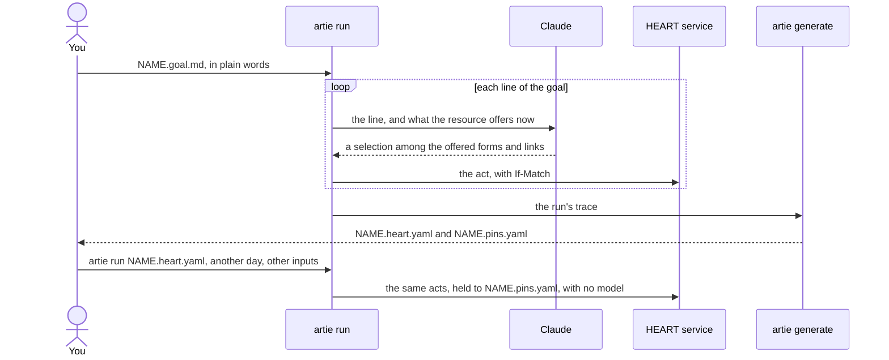

# ARTIE

ARTIE is a generic agent for any HEART service, the way a browser is a generic client for any website. It reads
what a service answers, follows the links it offers and fills the forms it offers, and it knows nothing about any
one service.

`artie` is its command line. It does three things:

1. **Walks a goal**, a job written in plain words, with a model choosing at each step among what the resource in
   hand offers.
2. **Keeps the walk** as a script held as data, in YAML: every act named by its relation, every value an input or a
   reference to what the walk found, and a lock file of what each act was offered.
3. **Replays the script** with no model, held to its lock file, so a run stops before it sends anything the service
   no longer offers the way it did.

To try it on your own GitHub, in Docker, with nothing else to install: [`kit/`](../kit/README.md).
The whole of it in diagrams: [HEART and ARTIE](https://jogoshugh.github.io/heart-rise-artie/reports/heart-artie-diagrams/)
(`docs/reports/heart-artie-diagrams/`).

## The chain



| File | Written by | What it is |
|---|---|---|
| `NAME.goal.md` | you | The job in plain words, with its inputs. No tool changes it. |
| `runs/NAME-<time>.trace.yaml` | `artie run` | Every step of a run: what was offered, what was chosen, where each value came from, the answer. |
| `NAME.heart.yaml` | `artie generate --format yaml` | The kept script: the walk as data. |
| `NAME.pins.yaml` | `artie generate` | The lock file: each form the script uses, by integrity, and the sets it was offered in. |
| `NAME.config.yaml` | you, optionally | How a run holds to the lock file, and what it does when a form changed. No tool writes it. |

A kept script and its lock file change only by `artie generate`, or by a repair the config allows a run to keep.

## Quick start

From `exhibits/github-task-yaml/`, against the GitHub gateway on `https://localhost:8392` (set up as in
[Build and set up](#build-and-set-up)), on a scratch repository of your own:

```sh
# Claude walks the goal once: an issue, a branch, a commit, a pull request merged, the issue closed.
artie run github-task.goal.md owner=$OWNER version=1.2 --reasoner claude \
  --entry https://localhost:8392/ --trace runs/mine.trace.yaml

# The walk, kept.
artie generate runs/mine.trace.yaml --script github-task.goal.md --out mine.heart.yaml --format yaml
#   wrote mine.heart.yaml: 0 values to review
#   wrote mine.pins.yaml: 10 forms and 0 links pinned

# The same job for another release, with no model, held strictly to what the walk was offered.
artie run mine.heart.yaml owner=$OWNER version=1.3 --entry https://localhost:8392/ --guard strict
```

`0 values to review` means every value came from an input or from what the walk found. A value the model chose,
with nothing to read it from, is marked `review:` in the script.

## Goals

A goal is `NAME.goal.md`: front matter, a paragraph or two of context, then the steps as a bulleted list.

```markdown
---
start: https://localhost:8392/
inputs:
  owner:   { question: "Whose repository?" }
  repo:    { default: heart-github-test, question: "Which repository?" }
  stamp:   { default: { now: MMdd-HHmmss } }
  version: { question: "Which release ships the fix?" }
---

Fix the blank-bed-name crash, start to finish.

- In {owner}/{repo}
  - Open an issue titled "Crash when a bed has no name", saying it was opened by a HEART script `as issue`
- Open the branch main of {owner}/{repo}
  - Start a new branch from here, named fix-blank-names-{stamp}
    - Commit a file named fix-{stamp}.md saying "Bed names may not be blank." with the message "Refuse a bed with no name"
    - Open a pull request into main titled "Refuse a bed with no name", saying it relates to #{issue.number} `as pr`
      - Wait: the pull request can be merged
      - Merge it by squashing its commits
- On {issue}
  - Comment "Fixed in {version} by #{pr.number}."
  - Close it the right way: the fix shipped in {version}
  - Verify:
    - it is closed
    - its reason is completed
```

**Front matter.** `start` is the one address the run begins from. Each input is `name: value`, `name:`,
`name: { default, question }`, or `default: { now: PATTERN }` for the time now in a `java.time` pattern. A missing
input stops the run before its first request, unless `--interactive` lets it ask. `limits: { moves: N, step: N }`
caps how many moves the model may make in the run and in one step.

**Steps.**

| Written | Is |
|---|---|
| `- words` | One step: one or more acts that do what the words say. |
| an item with sub-items | A step, then its sub-items inside the resource it led to. |
| `` `as name` `` at an item's end | Keeps the resource the item led to, as `name`. |
| `` `reasoned` `` at a leaf item's end | The model decides this step on every run of the kept script too. |
| `- Wait: condition` | Reads again until the condition holds. |
| `- Verify: fact`, or `- Verify:` with facts below | Each fact must hold now. |
| `` `moves N` `` at an item's end | Caps the model's moves for that item. |

**Names in braces.** `{name}` is an input or a kept resource; `{pr.number}` is a member of a kept resource's state,
read when the step runs. `{{` and `}}` are literal braces.

**Watches.** A goal can keep watching, until something says stop:

```markdown
- In {owner}/{repo}
  - Open an issue titled "Close-out watch", saying "Close this issue to stop the watch." `as watch`
  - Whenever an issue labelled {label} changes `as issue`
    - If it's closed, leave it.
    - If it's labelled {shipped}, comment "Fixed in {version}."
    - If it's labelled {shipped}, close it as completed.
    - If it's labelled {wontfix}, close it as not planned.
    - If it's labelled {duplicate}, close it as a duplicate.
- Until someone closes {watch}
```

| Written | Is |
|---|---|
| `- Whenever a … changes` | For each member of a list that changed since the last look, its sub-items. |
| `- If …, …` | A case. The model decides it on the walk; the kept script keeps it as facts on the member's state. |
| `- If …, leave it.` | Members to leave alone. |
| `- Once …, … Or give up after 3 minutes. Otherwise, …` | An act when it's offered, a deadline, and what to do instead. |
| `- Until …` | When the watch ends. |

Write one `If` per act. A case the walk never meets stays in words in the kept script, for the model, so stage every
case you mean to keep: `exhibits/github-task-yaml/closeout.sh` stages one issue per case before the walk.

`artie run NAME.goal.md --plan-only` reads, checks and prints a goal, and sends nothing.

## Kept scripts

`artie generate --format yaml` writes the walk as data. The start of `github-task.heart.yaml`:

```yaml
heart: 1
kind: kept
start: https://localhost:8393/

inputs:
  owner:
    question: Whose repository?
  stamp:
    default:
      now: MMdd-HHmmss

steps:
  - act: github:repos-get
    fields:
      owner: ${owner}
      repo: ${repo}
    inferred: get repository ${owner}/${repo}
    from-intent: In ${owner}/${repo}
    then:
      - act: github:open-issue
        fields:
          title: Crash when a bed has no name (steps)
          body: Opened by a HEART script.
        intent: Open an issue titled "Crash when a bed has no name (steps)", saying it was opened by a HEART script
        then:
          - keep-as: issue
```

`${owner}` is an input, `${issue.number}` a member of a kept resource. Each act keeps its words: `intent`, a
person's; `inferred`, the model's, for a step the goal didn't say in so many words; and `from-intent`, the person's
words that inferred words serve.

| Key | What it does |
|---|---|
| `heart: 1`, `kind` | The format, and the kind: `kept` names each act; `intent` says each act in words only, for the model on every run. |
| `start`, `inputs` | Where the run begins, and its inputs, as a goal declares them. |
| `act`, `fields` | An act by its relation, with its fields. |
| `intent`, `reasoned: true` | With no `act`: a reason step, chosen by the model on every run. |
| `follow`, `title` | A link, by relation and title. |
| `then` | The steps inside the resource an act or a link led to. |
| `keep-as` | Keeps that resource, as `${name}`. |
| `sync: true` | Reads the resource again. |
| `until` | Reads again until a form is `offered`, or until `facts` hold. |
| `check` | Facts that must hold now: each a `field` that `is` or `has` a value. |
| `watch` | Steps again and again, `until` facts hold, `at` a kept resource. |
| `whenever` | For each member that changed: which members (`has`), which to leave (`leave-where`), and acts by facts (`given`, `then`). |
| `once` | An act when it's `offered`, a `give-up` deadline, and steps `otherwise`. |

After each act, a kept script checks what the act changed, as the walk recorded it, leaving out values that differ on
every run, such as times and hashes. `artie generate --intents --format yaml` writes the walk in words only
(`kind: intent`), for the model to choose every act again on every run.

**The hybrid.** A goal step marked `` `reasoned` `` stays a reason step in the kept script, and everything else is
pinned. `artie generate` says so (`1 reason step kept`), and a run of the script needs `--reasoner`.

## Lock files and guards

The lock file says what the walk was offered:

```yaml
rung: L0
digest: sha256-ZfehRBgN7cn1JmGaca69chw2YnbEaHmTOUgAeGjWolE=
forms:
  github:open-issue:
    integrity: sha256-DkhI+JBXfAJQrcEsPIy8+AzCiYOtFzSaKOQ0N/UXTxI=
    act: sha256-zSq9d1NxXf4kXLKZaTlHo/9x0j+E3X2SJkMhbOdk21U=
    method: POST
    sets: []
```

`integrity` is the form as the service served it; `act` is the same with its target set aside. Before every act,
the run holds the form it is about to use to the lock file, as `--guard` says:

| `--guard` | What it checks |
|---|---|
| `strict` | The same form, in a set recorded for it. Anything else is refused. For audited work. |
| `lenient` | The default. The same form, or the same act whose target alone changed. A changed form it uses is refused; a change elsewhere is not. |
| `look-then-leap` | One look at the service's forms at the start. If nothing it compares has changed, the rest of the run is off the rails; otherwise lenient. |
| `off-the-rails` | No pins, no schema check, no reading again: recorded addresses fetched directly. It still sends the last ETag, a 412 still stops the run, and the service still enforces its rules. |

A refusal stops the run before anything is sent for that act.

**The config**, `NAME.config.yaml` beside the script, says what a lenient run does when a form it uses changed:

```yaml
guard: lenient          # strict, lenient, look-then-leap or off-the-rails
on-change: refuse       # refuse; values: go on when the method is the same and every value sent fits the new
                        # schema; intent: give that one step's words to the model, with the form as offered now
keep: never             # never, propose, or auto: write a repair that worked into the script and its lock file
repin: never            # never, propose, or auto: record a new set whose forms held, so strict holds as well
look: used              # used or everything: what look-then-leap compares
validators: last        # last, or none: a blind write, which a HEART service refuses unless set to allow it
```

`keep: auto` keeps a repair only when the run finished, the repair made the act the script was making, and every
value it sent is the script's own, written as the script wrote it, so an input stays an input. A flag on the command
line wins over the config.

## Levels of care

One job can run at five levels, each made from one walk by `artie generate`. Going down, the model does less and
the script says more.

| Level | File | Who decides each step | Model on every run |
|---|---|---|---|
| 1. The goal | `NAME.goal.md` | The model, reading each line | Every step |
| 2. The walk in words | `NAME.intent.heart.yaml` (`--intents`) | The model, choosing from what is offered | Every act |
| 3. Kept | `NAME.heart.yaml` | The script, held to its lock file | Only `reasoned` steps |
| 4. Kept, trusting more | `NAME.heart.yaml --guard look-then-leap` or `off-the-rails` | The script, checking less | Only `reasoned` steps |
| 5. Bare | `NAME.bare.kts` (`--bare`) | The script, at fixed addresses, no HEART | Only `reasoned` steps |

## Kotlin scripts

Scripts can also be written, or generated, in Kotlin: `artie generate` writes Kotlin unless `--format yaml` is
given, and a person who wants code beyond the vocabulary writes `.kts` by hand. The guard and the lock file are the
same.

```kotlin
val owner by input()
val repo by input()

heart("https://localhost:8392/") {
    act("github:issues-get", "owner" to owner, "repo" to repo, "issue_number" to 7L) {
        act("github:comment", "body" to "Fixed in 1.2.", intent = "Say it is fixed in 1.2")
        act("github:close", intent = "Close it")
    }
}
```

Bare scripts (`--bare`), which call the upstream API directly at fixed addresses, are Kotlin only.
`exhibits/merge-watch/` runs one job at every level, in Kotlin.

## Build and set up

ARTIE builds with Java 21 and a Java 22 toolchain, and `artie` runs on Java 22 or later.

```sh
cd client
JAVA_HOME=$HOME/.sdkman/candidates/java/21.0.12-graal ./gradlew :artie-cli:installDist
. scripts/.env          # puts artie on the PATH and reads the token and model key from where they live
```

`scripts/.env` holds no secret itself. It reads each one, when sourced, from where it already lives.

**Credentials** are by origin, never in a script. ARTIE looks in three places, in order:

1. Environment variables named by origin: `https://localhost:8392` reads `ARTIE_TOKEN_LOCALHOST_8392` (a bearer
   token), or `ARTIE_USER_…` and `ARTIE_PASSWORD_…` (Basic). The scheme is not in the name.
2. `~/.artie/credentials`, one section per origin, readable by its owner only:
   ```ini
   [https://localhost:8392]
   bearer = …
   ```
3. Vault, when `ARTIE_VAULT_ADDR` is set.

A credential goes over plain HTTP only to this machine.

**A local gateway over HTTPS** needs its certificate trusted:

```sh
export JAVA_OPTS="-Djavax.net.ssl.trustStore=$HOME/.cache/artie/tls/trust.p12 -Djavax.net.ssl.trustStorePassword=changeit"
```

Without it, a run against `https://localhost:8392` stops with "PKIX path building failed". The kit (`kit/`) runs the
gateway on plain HTTP inside its container instead, beside `artie`, so it needs no certificate.

**The GitHub gateway**, from `heart/`, reads GitHub's OpenAPI description and the connector in
`heart/heart-gateway/connectors/github`, and calls GitHub with each caller's own token:

```sh
cd heart && ./gradlew :heart-gateway:installDist
cd heart-gateway
UPSTREAM_URL=https://api.github.com \
UPSTREAM_SPEC=$HOME/.cache/artie/ghdesc/api.github.com.json \
UPSTREAM_AUTH=caller \
GATEWAY_CONNECTOR=build/install/heart-gateway/connectors/github \
GATEWAY_TLS_KEYSTORE=… GATEWAY_TLS_PASSWORD=… PORT=8392 \
  build/install/heart-gateway/bin/heart-gateway
```

GitHub's description is MIT licensed, from `github/rest-api-description`.

**The model**, for `--reasoner claude`, reads `ANTHROPIC_API_KEY`, or else the bearer entry for
`https://api.anthropic.com` in the credentials. A model on this machine takes the same prompts:
`--model-url http://localhost:11434 --model qwen3:30b-a3b-instruct-2507-q4_K_M` asks Ollama's Messages API instead of
Anthropic's (`spec/PLAN-LOCAL-MODEL.md`).

## `artie run`

```
artie run <script> [name=value …] [options]
```

`<script>` is a goal (`.goal.md`), a kept script (`.heart.yaml` or `.kts`) or a bare script (`.bare.kts`), in the
current folder.

### Inputs

| Option | What it does |
|---|---|
| `name=value` | Gives the input `name`. Repeat it for each one. |
| `--inputs FILE` | Reads inputs from a JSON or YAML file. Values given on the line win. |
| `--interactive` | Asks a person for each input the script still needs, and for each `ask(…)` in it. Without it, a missing input stops the run before its first request. |
| `--inputs-of` | Lists the script's inputs, without running it. |
| `--plan-only` | For a goal: reads, checks and prints it, with nothing sent. |

### Where and how it reads

| Option | What it does |
|---|---|
| `--entry URL` | Starts at another address than the one the script or goal names: the same script against another server. |
| `--rung L0\|L1\|L2` | Which rung of HEART the client asks for. L0 gets forms and schemas inline; L1 and L2 get them by link, shared and cached. A kept script reads at the rung its lock file records. |
| `--dialect hal-forms\|hal-schema-forms` | The dialect asked for; HAL Schema Forms by default. |
| `--reasoner claude` | Allows the steps that need a model: every step of a goal, and a kept script's reason steps. |
| `--model NAME` | The model the reasoner asks, as its runtime names it. |
| `--model-url ORIGIN` | Where the model answers the Messages API, such as `http://localhost:11434` for Ollama. |
| `--max-tokens N` | The most an answer may run to. A model that thinks before it calls the tool needs 4096. |
| `--remember FILE` | For a watch: keeps what it did in FILE, so that run again it doesn't do it again. |

### Guards

| Option | What it does |
|---|---|
| `--guard strict\|lenient\|look-then-leap\|off-the-rails` | How a kept script holds to its lock file ([Lock files and guards](#lock-files-and-guards)). |
| `--pins FILE` | Holds to another lock file than `NAME.pins.yaml` beside the script. |
| `--config FILE` | Reads another config than `NAME.config.yaml` beside the script. |
| `--no-repin` | Leaves the lock file as it is, whatever the config says. |
| `--look used\|everything` | What `look-then-leap` compares. |
| `--validators last\|none` | What each act carries in `If-Match`: the last ETag for that resource, or none. |

### What the run writes

| Option | What it does |
|---|---|
| `--trace FILE` | Writes the trace to FILE instead of `runs/NAME-<time>.trace.yaml`. It holds every step: what was asked, the values sent and where each came from, the answer, the guard's check, and the run's inputs. |
| `--exchanges` | Keeps each request and answer in the trace, with its `traceparent`, so the gateway's record of its upstream calls can be joined to the step. |
| `--report DIR` | Builds an HTML report of the run in DIR, from the trace. |
| `--quiet` | Prints only the last line. |
| `--output json` | Prints the outcome as one JSON object. |

By default, `artie run` prints one line per step and a last line saying how the run ended, such as
`finished, 15 steps; acted: github:repos-get 1, github:open-issue 6`.

### Exit codes

| Code | Meaning |
|---|---|
| 0 | Finished, or listed (`--inputs-of`, `--plan-only`) |
| 1 | A check or an expectation in the script was not met |
| 2 | Stopped before the first request: bad arguments, a missing input, no lock file for `--guard`, a rung other than the lock file's |
| 3 | Refused by the server or by the guard |
| 4 | The client failed: the network, TLS, a server error |
| 5 | The script has an error |

## `artie generate`

```
artie generate <trace.yaml> --out <script> [--format kts|yaml] [--script <source>] [--intents] [--keep-reason]
               [--inputs a,b] [--report <dir>]
artie generate <trace.yaml> --bare <upstream.yaml> --out <script.bare.kts>
```

`<trace.yaml>` is a run's trace, from `artie run`.

| Option | What it does |
|---|---|
| `--out FILE` | The script to write. Beside it, its lock file `NAME.pins.yaml`. |
| `--format kts\|yaml` | Kotlin, the default, or a script held as data. |
| `--script FILE` | The goal or script the run ran. With a goal, the script follows its lines, keeps its words as each act's `intent`, and keeps its `reasoned` steps. |
| `--intents` | Writes the walk in words only, for the model to choose on every run. |
| `--keep-reason` | Keeps each step the model reasoned as a reason step, instead of writing down the choice it made. |
| `--inputs a,b` | Makes the values the run sent under these fields into inputs, defaulting to what was sent. |
| `--report DIR` | A derivation report: the source and the generated Kotlin script side by side, each derivation numbered on both (needs `--script`; Kotlin only). |
| `--bare FILE` | A bare Kotlin script, from the gateway's upstream record FILE: each act the call it came down to, at a fixed address. Needs a trace kept with `--exchanges`. |

## The modules

| Module | What it is |
|---|---|
| `heart-script` | The scripting language: kept scripts as data and as Kotlin, waits and watches, facts, and the bare vocabulary |
| `artie` | The client: HTTP and CoAP bindings, caching, validators, credentials, the reasoner, the guards |
| `artie-cli` | The `artie` command: `artie run` and `artie generate` |
| `heart-script-host` | Compiles and runs `.kts` scripts |
| `heart-script-test` | Expectations a script can state about a run, for tests written as scripts |

## Further reading

- `kit/README.md`: ARTIE on your own GitHub, in Docker
- `exhibits/github-task-yaml/`: from a goal to YAML, the hybrid, and the close-out watch, run live
- `spec/SPEC.md` §9.4: scripts and replay
- `spec/PLAN-GOAL-MARKDOWN.md`: goals in plain words
- `spec/PLAN-KEPT-SCRIPTS-AS-DATA.md`: kept scripts as data
- `spec/PLAN-SCRIPT-GENERATOR.md`: `artie generate` and lock files
- `spec/ideas/replay-guards-lenient-strict.md`, `spec/ideas/self-repair-and-keep.md` and `spec/ideas/off-the-rails.md`: the guards and repair
- `docs/reports/`: the reports, on GitHub Pages
