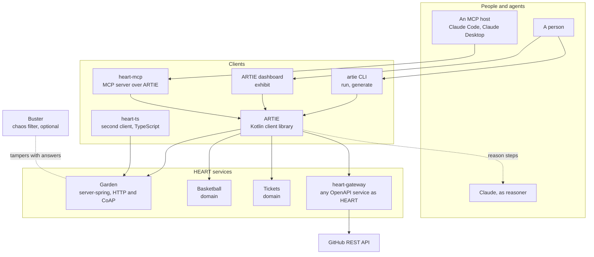
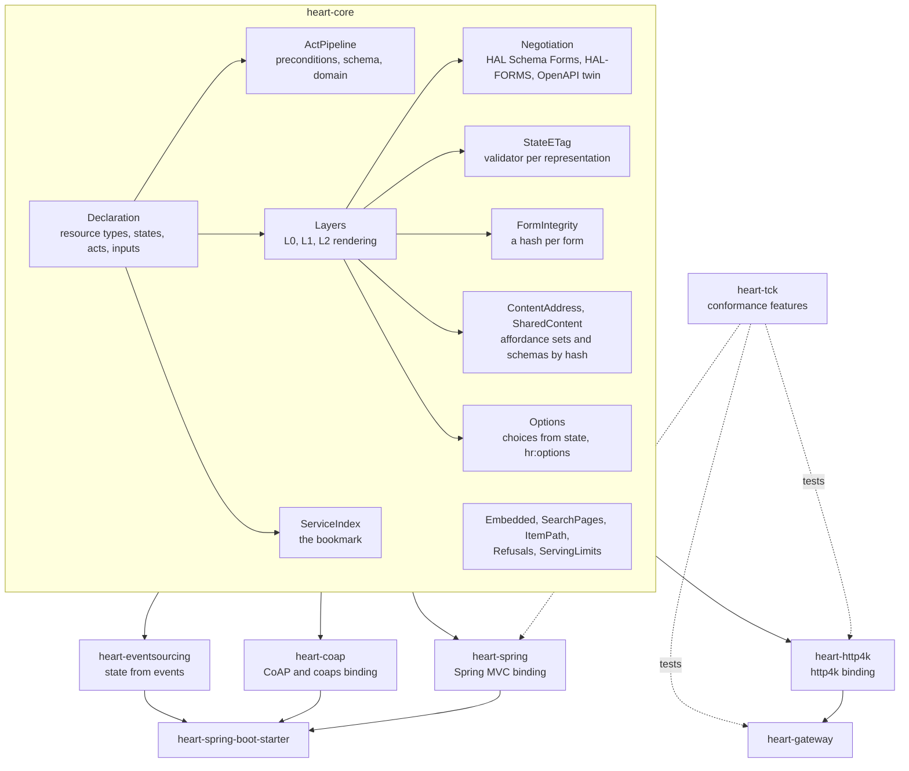
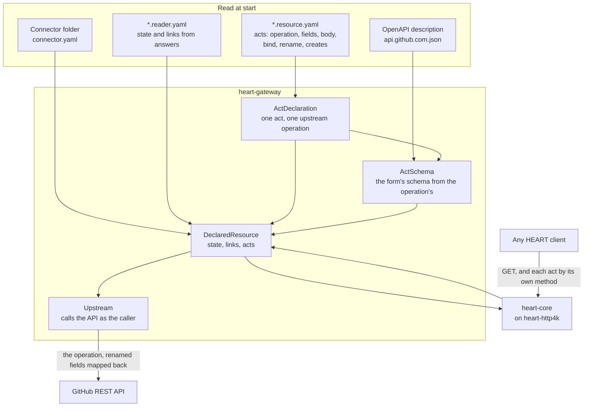
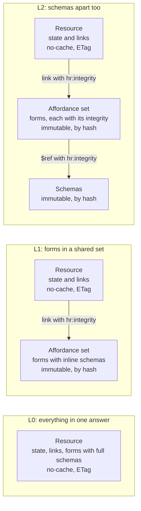
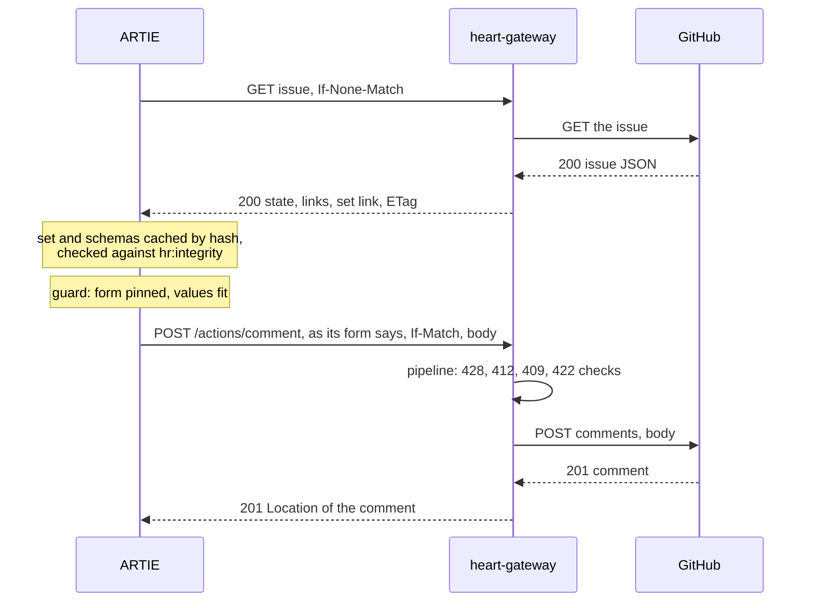
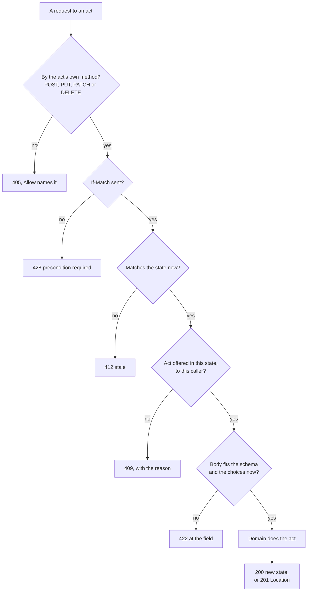
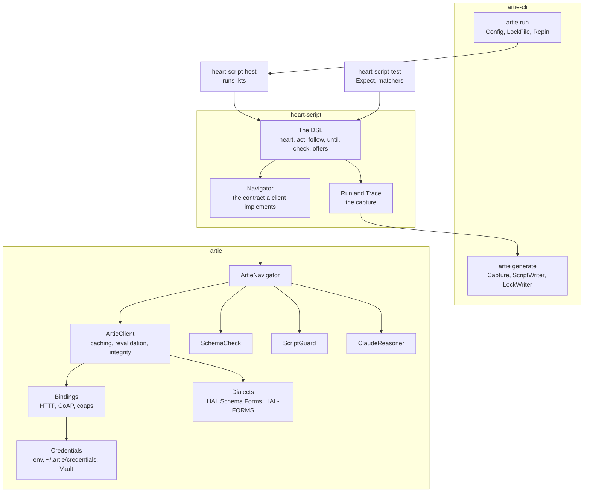
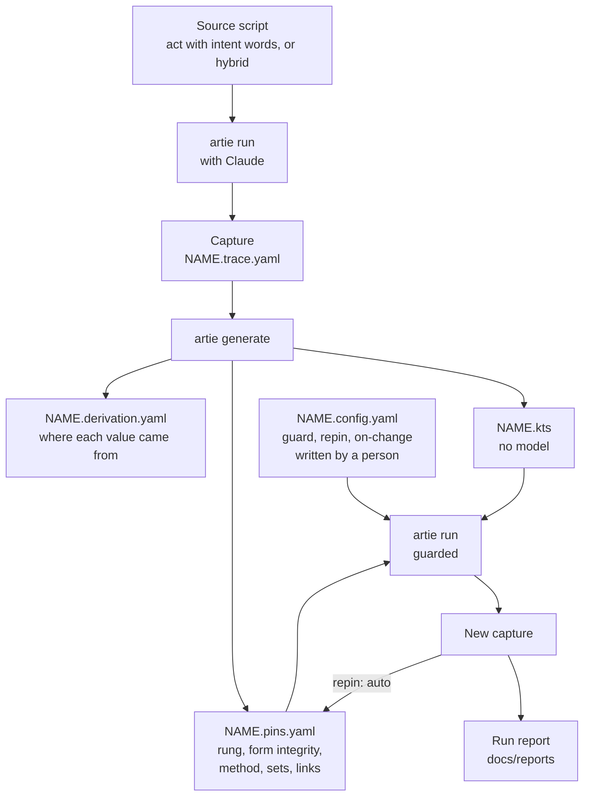
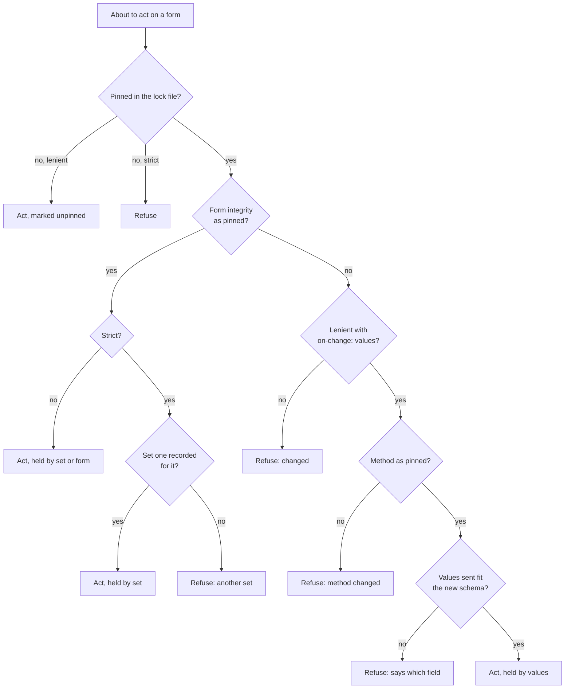
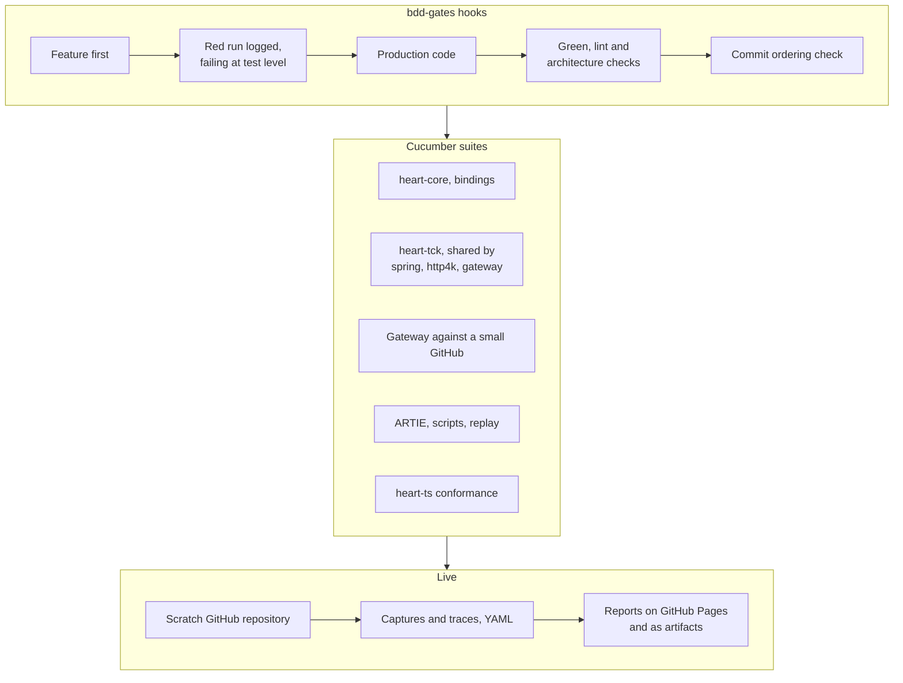

# HEART architecture diagrams

The Mermaid sources of [the architecture report](index.html), October 20, 2026. Paste any block into Markdown that renders Mermaid.

## 1. The system

## 2. The server library

## 3. The gateway

## 4. Rungs and layers

## 5. One act, end to end

## 6. The act pipeline

## 7. The client

## 8. Scripts, captures and lock files

## 9. The replay guard

## 10. How it is tested

