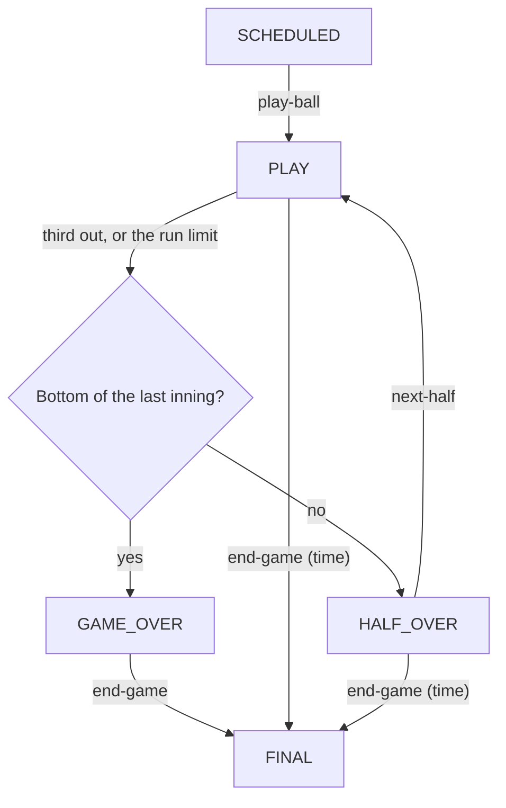

# Youth baseball scoring, 8U coach pitch

A HEART domain server, built like the basketball one (`../basketball`): its domain code and one declaration. The
HEART library (`heart/`) serves it over HTTP and CoAP; it has no controllers.

- A game is one resource, `/games/{id}`.
- Its state is the inning and which half, who is batting and who is up, the outs, the pitches to this batter, who
  is on which base, the line score, and each player's hits and runs.
- What may be recorded depends on the game's phase:

| Phase | Offered |
|---|---|
| `SCHEDULED` | play-ball |
| `PLAY` | pitch, hit, runner-out, end-game |
| `HALF_OVER` | next-half, end-game |
| `GAME_OVER` | end-game |
| `FINAL` | nothing |

<details>
<summary>Diagram: how acts move a game through its phases</summary>



</details>

League rules (`Rules` in `domain/Game.kt`, one place, so a league's own numbers drop in):

- Six innings, three outs a half.
- A half ends at five runs, except in the last inning.
- A coach pitches: no balls, no walks. Six pitches a batter; a miss on the sixth is out, a foul on it gives one
  more.
- The whole team bats, in order; the order carries on from inning to inning.
- On a hit every runner moves up as many bases as the batter.
- The umpire may end a game early, for time.
- A runner can be put out only on a base that has one; else 422 at `/base`.

## Code

| Package | Holds |
|---|---|
| `domain` | Events, the state and its fold, the rules a schema cannot say (`GameService`) |
| `declaration` | The vocabulary (`BaseballProfile`), the resource type (`Games`), act inputs, what each act records (`GameActs`) |
| `store` | Games' identities and lineups, in memory or Postgres |
| `config` | The `HeartResource` bean, and the Postgres stores |

## Run

```
../../scripts/dev-credentials.sh   # once: a Bearer token, its SHA-256 in .env, the token in ~/.artie
docker compose -f ../../server-spring/docker-compose.yml up -d postgres
./reset-db.sh                      # first time: creates the baseball database
set -a; . ./.env; set +a           # the service admits only that token, and will not start without one
./gradlew bootRun                  # HTTP on 8383, CoAP on 5686 (loopback only); migrates
./reset-db.sh                      # seeds game 1 (scheduled) and game 2 (the bottom of the second)
```

Tests: `./gradlew test` runs the game rules (`game.feature`), the HEART conformance features (`RunHeartTckTest`),
the architecture rules, and the whole server on Postgres in Testcontainers.

## Your own sport

Volleyball, soccer, anything scored: copy this folder and change four things.

1. `game.feature`: the rules, as scenarios, first. Run them and watch them fail.
2. `domain`: the events (what can happen), the state and its fold, and `Rules`.
3. `declaration`: the acts, which phase offers which, and why each is absent.
4. `store` and the migration: the teams.

The HEART library does the rest: the forms, the refusals, the history, HTML for a browser and JSON for ARTIE.
