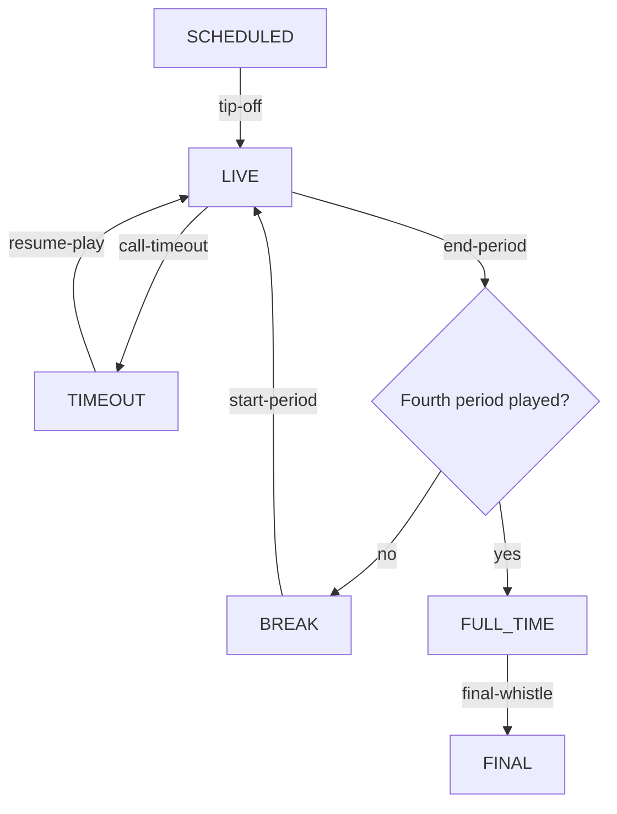

# Youth basketball scoring

A HEART domain server (spec/PLAN-HEART-LIBRARY-DOMAINS-EVAL.md, B2): its domain
code and one declaration. The HEART library (`heart/`) serves it over HTTP and
CoAP; it has no controllers.

- A game is one resource, `/games/{id}`.
- Its state is the score, the period, possession, every player's points and fouls, each team's fouls this half,
  and the scoring plays.
- What may be recorded depends on the game's phase:

| Phase | Offered |
|---|---|
| `SCHEDULED` | tip-off |
| `LIVE` | score-basket, free-throw, record-foul, turnover, call-timeout, end-period, correct-score |
| `TIMEOUT` | resume-play, correct-score |
| `BREAK` | start-period |
| `FULL_TIME` | final-whistle |
| `FINAL` | nothing |

<details>
<summary>Diagram: how acts move a game through its phases</summary>



The other acts offered in `LIVE` and `TIMEOUT` leave the phase as it is.

</details>

Youth rules:

- Four periods.
- A player fouls out at 5 personal fouls.
- A team is in the bonus once the other team has 7 fouls in the half (team fouls reset at half time).
- A player not on the roster, or fouled out, is refused with 422 at `/playerNumber`.
- Only a scoring play can be taken back, once.

## Code

| Package | Holds |
|---|---|
| `domain` | Events, the state and its fold, the rules a schema cannot say (`GameService`) |
| `declaration` | The vocabulary (`BasketballProfile`), the resource type (`Games`), act inputs, what each act records (`GameActs`) |
| `store` | Games' identities and rosters, in memory or Postgres |
| `config` | The `HeartResource` bean, and the Postgres stores |

## Run

```
../../scripts/dev-credentials.sh   # once: a Bearer token, its SHA-256 in .env, the token in ~/.artie
docker compose -f ../../server-spring/docker-compose.yml up -d postgres
./reset-db.sh                      # first time: creates the basketball database
set -a; . ./.env; set +a           # the service admits only that token, and will not start without one
./gradlew bootRun                  # HTTP on 8181, CoAP on 5684 (loopback only); migrates
./reset-db.sh                      # seeds game 1 (scheduled) and game 2 (live)
```

Every state, act and the bookmark need the credential (SPEC §6.13). ARTIE and
heart-mcp find it in `~/.artie/credentials`.

Tests: `./gradlew test` runs:

- the game rules (`game.feature`);
- the HEART conformance features (`RunHeartTckTest`);
- the architecture rules;
- the whole server on Postgres in Testcontainers.
