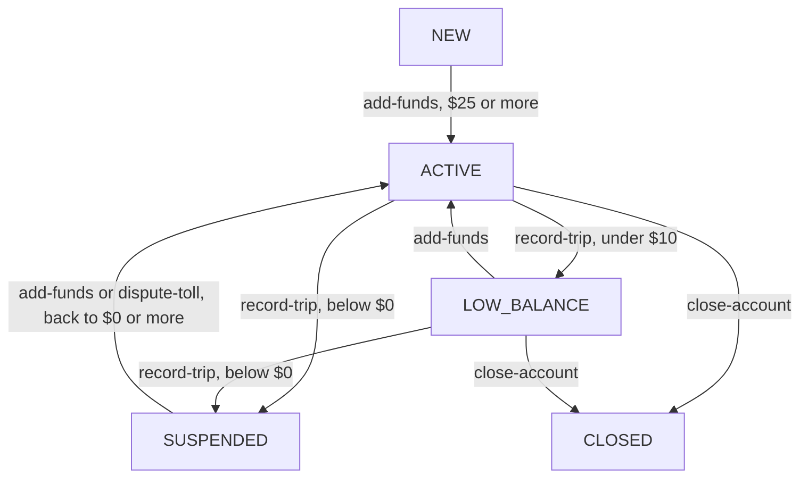

# Toll accounts and fares, E-ZPass style

A HEART domain server, built like basketball and baseball: its domain code and one declaration. The HEART library
(`heart/`) serves it over HTTP and CoAP; it has no controllers.

- An account is one resource, `/accounts/{id}`.
- Its state is the holder, the balance, the tags (lost ones still listed), and the statement: every payment and
  trip, in order, with which trips were refunded.
- What may be done depends on the account's phase, which follows from its balance:

| Phase | When | Offered |
|---|---|---|
| `NEW` | never funded | add-funds |
| `ACTIVE` | $10 or more | add-funds, add-tag, record-trip, report-tag-lost, dispute-toll, close-account |
| `LOW_BALANCE` | under $10 | the same as active |
| `SUSPENDED` | below $0: the tags no longer pay | add-funds, dispute-toll |
| `CLOSED` | closed, the balance refunded | nothing |

<details>
<summary>Diagram: how acts move an account through its phases</summary>



</details>

Toll rules (`Rules` in `domain/Account.kt`, one place):

- An account opens with at least $25; else 422 at `/amount`.
- A trip's fare: the plaza's peak car fare (Harbor Bridge $7.00, North Tunnel $6.50, Turnpike Exit 9 $3.25),
  80 % off-peak, times the vehicle class (car 1, two-axle truck 2, five-axle truck 5).
- A trip is charged to one of the account's tags that is not lost: the form says so (`hr:options` from `/tags`),
  and any other tag is not one of the choices (422 at `/tag`).
- A tag is on an account once (422 at `/tag`).
- A trip can be disputed, and refunded, once; only a trip (422 at `/sequenceNo`).
- A trip records the fare charged, so a later change to the fares never rewrites a past trip.

## Code

| Package | Holds |
|---|---|
| `domain` | Events, the state and its fold, the fares, the rules a schema cannot say (`AccountService`) |
| `declaration` | The vocabulary (`TollsProfile`), the resource type (`Accounts`), act inputs, what each act records (`AccountActs`) |
| `store` | Accounts' identities, in memory or Postgres |
| `config` | The `HeartResource` bean, and the Postgres stores |

## Run

```
../../scripts/dev-credentials.sh   # once: a Bearer token, its SHA-256 in .env, the token in ~/.artie
docker compose -f ../../server-spring/docker-compose.yml up -d postgres
./reset-db.sh                      # first time: creates the tolls database
set -a; . ./.env; set +a           # the service admits only that token, and will not start without one
./gradlew bootRun                  # HTTP on 8484, CoAP on 5688 (loopback only); migrates
./reset-db.sh                      # seeds accounts 1 (open), 2 (new) and 3 (suspended)
```

Tests: `./gradlew test` runs the account rules (`account.feature`), the HEART conformance features
(`RunHeartTckTest`), the architecture rules, and the whole server on Postgres in Testcontainers.

## Next: who may do what

Today every act is offered to whoever holds the credential. The next step is roles: the holder adds funds,
tags and disputes; a plaza charges trips; a customer-service agent refunds without a dispute; an auditor reads
everything and acts on nothing. Each reads the same account and is offered only their own acts.
