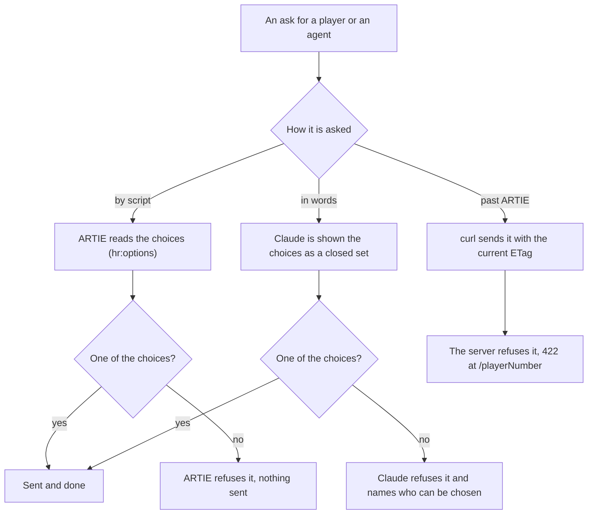
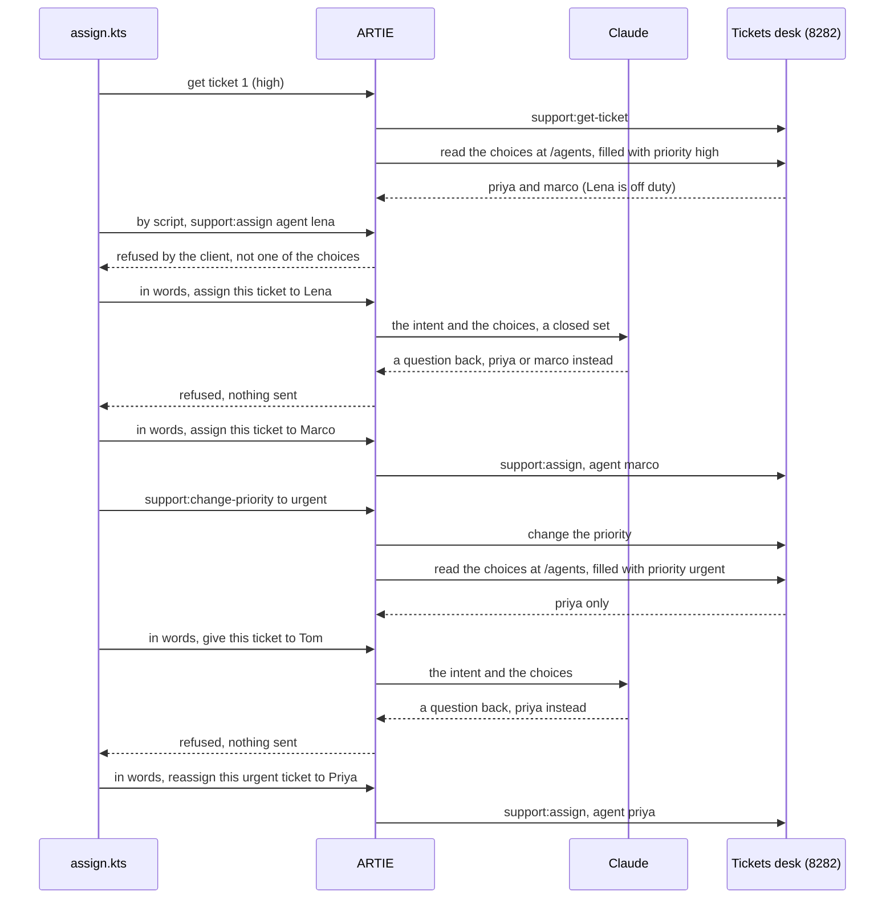

# Choices, live

HAL-SCHEMA-FORMS-HR Rule 8, choices from state (`hr:options`), on two live domain services:

- **basketball**: record-foul's player is one of the chosen team's players who have not fouled out. The
  choices come from the game itself, at `/{team}/players`.
- **tickets**: assign's agent is one of the desk's agents who handle the ticket's priority and are on duty.
  The choices come from another resource, `/agents{?priority}`, filled from the ticket.

Each was asked for values inside and outside the choices in three ways: by script, in words to Claude, and
past ARTIE straight to the server.

<details>
<summary>Diagram: one ask, three ways</summary>



</details>

## The pieces

- `foul-out.kts`: game 2 is live.
  - The script fouls Rowan (8) out with four more fouls, then asks for a fifth, by script and in words.
  - Then, in words, it asks for a foul on Kai.
- `assign.kts`: on ticket 1 (high), it asks for Lena, who is off duty, by script and in words, then for Marco.
  - Then the ticket goes urgent, and it asks for Tom and then for Priya.
- `runs/`: each run's output and trace.
  - `assign-1.kts` is the first version of `assign.kts`, which asked for "someone who can take it now".
  - `server-refuses.yaml` is the foul on Rowan sent with curl and the game's current ETag.
- `results.yaml` holds the rows the report shows, read from those runs. `report.kts` makes the report
  `docs/reports/choices-live/index.html` from it.

<details>
<summary>Diagram: the choices follow the ticket's priority</summary>



</details>

## Running it

Postgres from `server-spring` must be up, with basketball on 8181 and tickets on 8282 (see each domain's
README). Run from this folder, with `artie` on the path (`. ../../client/scripts/.env`) and a model key:

```
../../domains/basketball/reset-db.sh
artie run foul-out.kts --reasoner claude --trace runs/foul-out-1.yaml
../../domains/tickets/reset-db.sh
artie run assign.kts --reasoner claude --trace runs/assign-2.yaml
artie run report.kts out=../../docs/reports/choices-live/index.html
```

## The runs of 2026-10-25

- Every ask for someone who can't be chosen now was refused before anything was sent: 6 of 6.
  - By script, ARTIE refused it.
  - In words, Claude refused it and named who can be chosen.
- Every ask for someone who can be chosen was done: 3 of 3.
- Sent past ARTIE, the server refused the foul on Rowan with 422 at `/playerNumber`.
- "Someone who can take it now", with two agents to choose from, got a question back, not a guess. ARTIE's
  reasoner asks when an intent fits more than one choice.
  - Saying "only these can be chosen now" in the choices' description did not change that, so the change was
    not kept.
- HAL-FORMS renders the same choices as inline values for one game. They can't depend on the team field, so it
  offers both teams' players.
