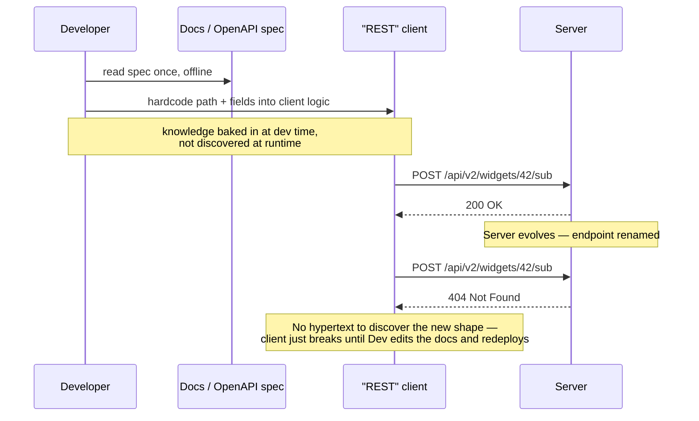
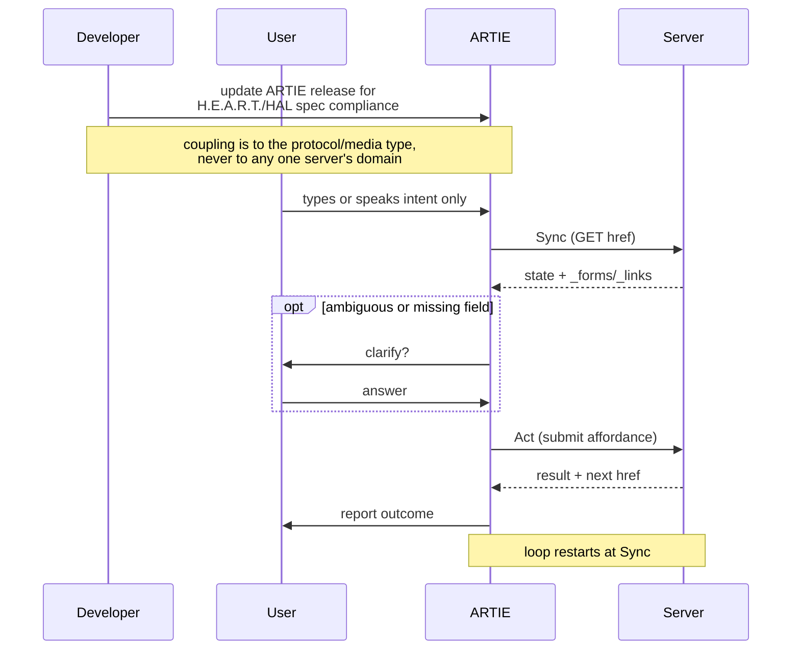
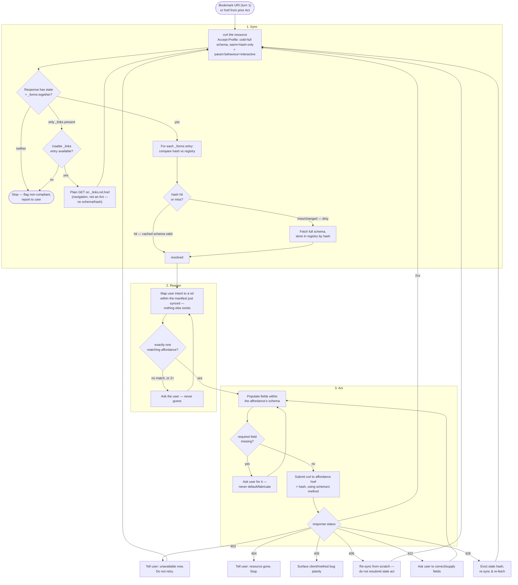

# ARTIE — Generic Sync-Reason-Act Loop

## The failure mode Fielding complained about (anti-pattern — not what ARTIE does)

## ARTIE loop, applying Fielding guidance

## Full detail, as a flowchart

A couple of things worth noting about how it's drawn: the `_links`-without-`_forms` branch
(`S4`/`S5`) is the HAL-navigation escape hatch added later — it loops back into Sync rather
than dead-ending. Also not shown: `DEBUG ON` logging is an orthogonal overlay that wraps
every `curl` call in this graph (screen print + YAML append) without changing the control
flow itself.
