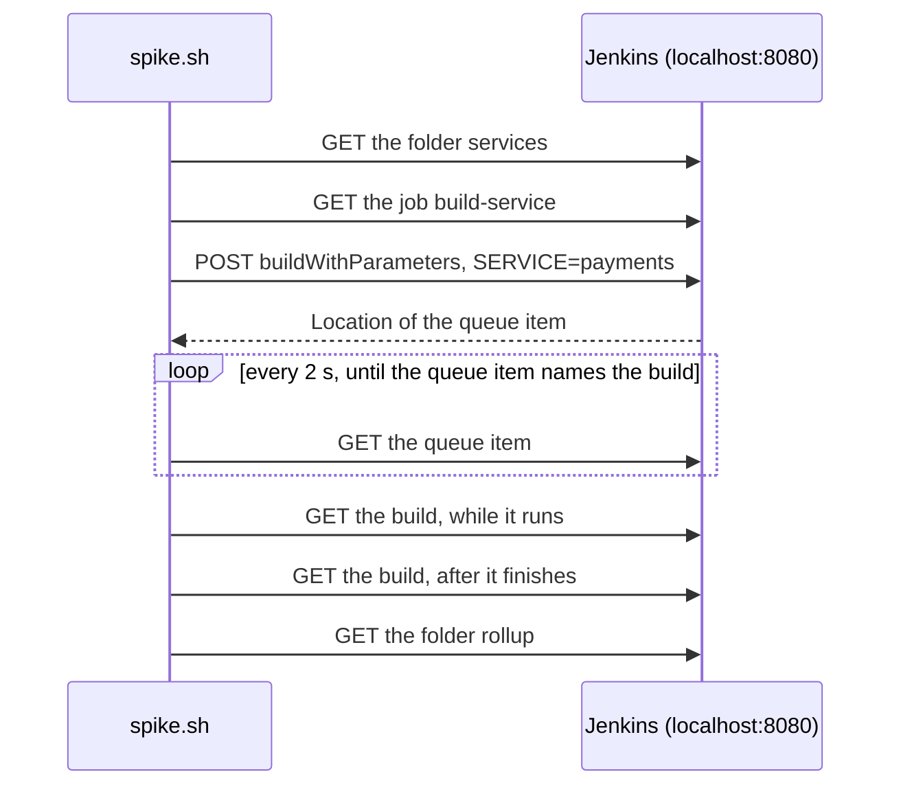

# A scratch Jenkins in Docker

The Jenkins the gateway idea in `spec/ideas/jenkins-gateway.md` needs:

- One container, a folder, one parameterised pipeline job, no setup wizard.
- Everything is configured by `casc.yaml` (Configuration as Code plus Job DSL), so the container comes up ready.
- `captures.yaml` holds the real answers Jenkins gave on 2026-10-29, which the OpenAPI slice and the connector will
  be written from.

## Run it

```bash
docker build -t heart-jenkins-spike .
docker run -d --name heart-jenkins -p 8080:8080 heart-jenkins-spike
until curl -s -o /dev/null -w '%{http_code}' http://localhost:8080/login | grep -q 200; do sleep 3; done
```

The admin user is `admin` with the password `spike-admin`, local to this container only.

## Make an API token

- Jenkins skips its anti-forgery crumb for requests authenticated with an API token, so the gateway and the scripts
  send Basic auth with the token.
- Making the token is the one request that needs the crumb:

```bash
U=http://localhost:8080; CJ=$(mktemp)
CRUMB=$(curl -s -u admin:spike-admin -c $CJ "$U/crumbIssuer/api/json" | jq -r .crumb)
curl -s -u admin:spike-admin -b $CJ -H "Jenkins-Crumb: $CRUMB" -X POST \
  "$U/user/admin/descriptorByName/jenkins.security.ApiTokenProperty/generateNewToken" \
  --data newTokenName=spike | jq -r .data.tokenValue > token
chmod 600 token; rm $CJ
```

- The `token` file is ignored by git.
- The container keeps no volume, so a restart forgets the token.

## The spike

`spike.sh`:

1. reads the folder and the job;
2. starts the job with `SERVICE=payments`;
3. polls the queue item until it names the build;
4. reads the build while it runs and after it finishes;
5. then reads the folder rollup.

`spike-fail.sh` starts a build with `SERVICE=broken`, which fails, so the rollup shows a last failure beside the
last success. Both read the token from the `token` file beside them.

<details>
<summary>Diagram: what <code>spike.sh</code> asks Jenkins</summary>



</details>

Two things to know when writing more of this:

- `curl` needs `-g`: the `tree=jobs[name,...]` brackets are otherwise taken as URL globs.
- Configuration as Code substitutes `${...}` in `casc.yaml` itself. A pipeline's `${params.SERVICE}`
  must be written `^${params.SERVICE}` or it arrives empty.
