# How HEART works

HEART (H.E.A.R.T.: Hypermedia Enforced Agentic Reliable Transactions, §1) is a
way for a server to tell any client, a person's app or an AI agent, exactly
what it may do next, in every response, and for that information to be cheap
to cache. The absence of an act is the enforcement, not an omission. This document shows how it works, rung by rung, and how the library in
`heart/` implements it.

The normative rules are in `spec/SPEC.md` (sections cited as §). How HEART
measures against Fielding's own rules is in
[`spec/FIELDING-REVIEW.md`](../spec/FIELDING-REVIEW.md). The reference
client, ARTIE, is described in `spec/ARCHITECTURE.md`.

Contents:
1. [HEART in one picture](#1-heart-in-one-picture)
2. [REST and the web, in summary](#2-rest-and-the-web-in-summary)
3. [The three layers](#3-the-three-layers)
4. [The rungs, L0 to L6](#4-the-rungs-l0-to-l6)
5. [Negotiation](#5-negotiation)
6. [The bookmark](#6-the-bookmark)
7. [Acts and refusals](#7-acts-and-refusals)
8. [Why an act is absent](#8-why-an-act-is-absent)
9. [One act, end to end](#9-one-act-end-to-end)
10. [Core and bindings](#10-core-and-bindings)
11. [The library, mapped to all of the above](#11-the-library-mapped-to-all-of-the-above)
12. [Glossary](#12-glossary)

---

## 1. HEART in one picture

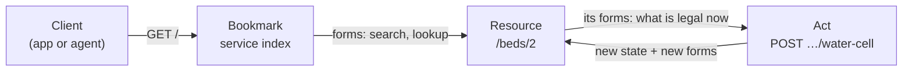

A client knows one URI, the bookmark. Every response it gets carries the
resource's **state** and the **forms** for the acts legal in that state, and
nothing else is legal. The client acts by filling in a form. The answer is the
resource's new state with its new forms. The cycle repeats.

Key words:
- **Resource**: a thing with a URI, such as `/beds/2`.
- **Representation**: what one response says about a resource.
- **Affordance** (or act): something the client can do next, such as watering.
- **Form**: an affordance written down: its target, method, and the JSON
  Schema of its body.
- **Relation**: the name of an affordance, such as `garden:water-cell`,
  defined in the server's ALPS profile.

## 2. REST and the web, in summary

REST is the architectural style Roy Fielding defined (2000) to explain why
the web scales. It is a set of constraints. HEART meets each one:

| Constraint | What it means | How HEART meets it |
|---|---|---|
| Client-server | Separate the user interface from data storage | The client knows only media types and relations; the server owns state and rules |
| Stateless | Each request carries all it needs | Dialect, rung and validator travel in every request (`Accept`, `Prefer`, `If-Match`); no session |
| Cache | Responses say whether they can be reused | Layer 1 `no-cache` (always revalidated, 304 when unchanged); Layers 2 and 3 `immutable`, named by their content |
| Uniform interface | One generic interface for every resource | See below |
| Layered system | Intermediaries can sit between client and server | A shared cache serves Layers 2 and 3 to many clients (L3), and integrity lets a client trust it; Layer 1 is never answered stale (`no-cache`; CoAP's critical No-Cache option) |
| Code on demand | Optional: the server may send code | Not used |

The uniform interface has four parts:

| Part | In HEART |
|---|---|
| Identification of resources | URIs; shared layers have content addresses (`/affordance-sets/sha256-…`) |
| Manipulation through representations | An act sends a body that satisfies the form's schema, with the representation's ETag in `If-Match` |
| Self-descriptive messages | Media type, profile `Link`, `Preference-Applied`, `Vary`, ETag, and RFC 9457 problem types say what each message is |
| Hypermedia as the engine of application state | The forms in each response are the only source of what the client may do next |

The last part is the one most "REST APIs" skip, and the one HEART is built
on. In 2008 Fielding wrote "REST APIs must be hypertext-driven", with six
rules. In short:

1. Do not depend on one protocol; allow any URI scheme. *(HTTP and CoAP bindings, chosen by scheme.)*
2. Do not change protocols; only fill in underspecified bits. *(Standard headers, used as written.)*
3. Spend the effort on media types and relation names. *(A profile of HAL plus typed relations; no endpoint list.)*
4. Do not fix resource names; let the server teach URIs, as forms and URI templates do. *(Targets come from forms; templates are filled by pointers the server gives.)*
5. No "typed resources" significant to the client, only media types and relations. *(A client keys on relations.)*
6. Enter with only the bookmark; every transition is chosen from what the server presented. *(The service index; nothing else is assumed.)*

[`spec/FIELDING-REVIEW.md`](../spec/FIELDING-REVIEW.md) checks every rule and
every comment he made on that post, with evidence, commit by commit.

## 3. The three layers

A representation is split into three layers, so the parts that change can be
fetched fresh and the parts that do not can be cached forever (§6.4, §6.5).

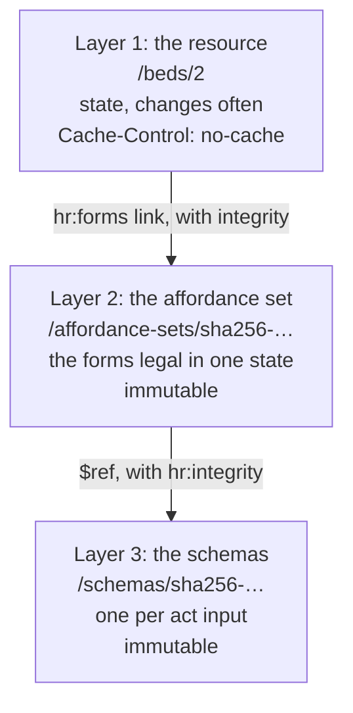

**Content addressing.** A Layer 2 or 3 body is canonical JSON (RFC 8785) and
its address is the first 16 hex digits of its SHA-256. The same bytes always
have the same address, so they can be cached with `immutable`. Every link to
one carries the full digest as Subresource Integrity, and the client checks
it, so a cache can never hand it the wrong bytes.

**Sharing.** The forms in a set are URI templates (`/beds/{id}/actions/water-cell`),
with `hr:templatePointers` saying where to find `id` in the state (`/id`).
So the set names no single bed, and every bed in one state links to the same
set:

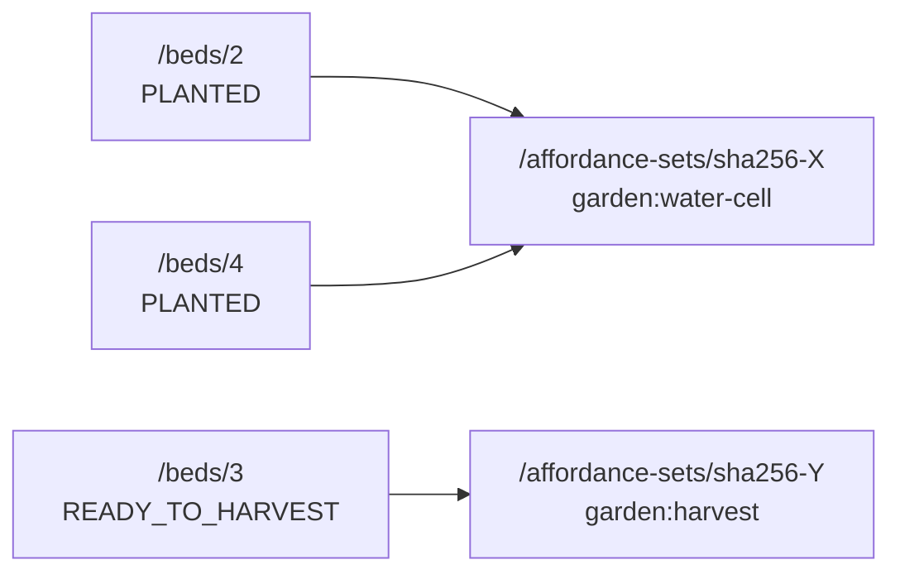

This works because the acts offered depend on the state's key alone, never
on one resource (§6.9).

## 4. The rungs, L0 to L6

A server and a client meet on a rung. L0 to L2 are how much is split out;
L3 to L5 are properties a server shows; L6 is optional reasoning (§6.10).

| Rung | Asked for with | What it adds |
|---|---|---|
| L0 | nothing | Everything in one response: state, forms, full schemas |
| L1 | `Prefer: forms=link` | Forms move to a shared, cached affordance set |
| L2 | `Prefer: forms=link, schema=link` | Schemas move out too; the reference rung |
| L3 | (a property) | Two resources in one state share one set: the second costs nothing |
| L4 | (a property) | Concurrency and errors: 428, 412, 409, 422 |
| L5 | `Accept` | Two dialects agree on what is legal |
| L6 | (client side) | A model picks the act; it never sees a URI |

L0 is correct but not economical: it is the on-ramp, and a server must reach
L2 to claim compliance. Each response says the rung it is at in
`Preference-Applied`, and a server caps the rungs it serves (`heart.max-rung`).

### L0: collapsed

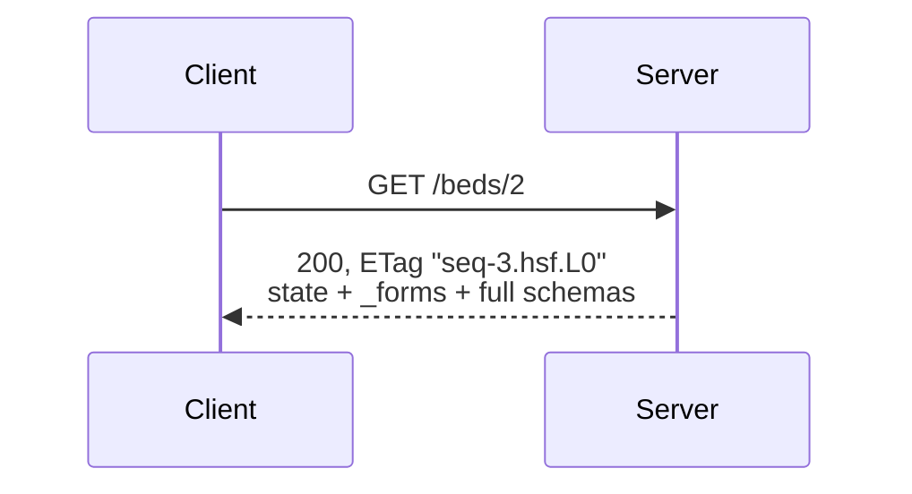

The forms' targets are concrete (`/beds/2/actions/water-cell`).

### L1: the set by link

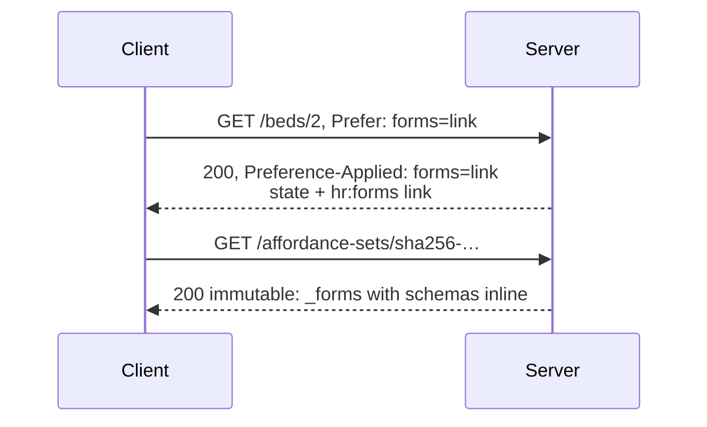

### L2: the schemas by link too

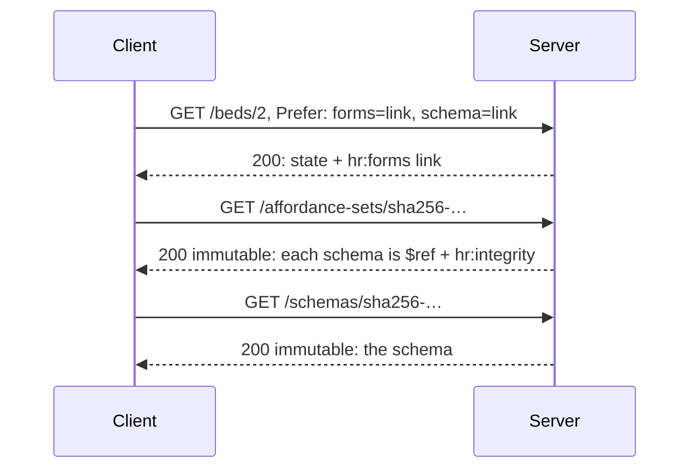

The L1 and L2 sets are different bytes, so they have different addresses.
After the first visit, an unchanged resource costs one request answered 304.

### L3: the caching proof

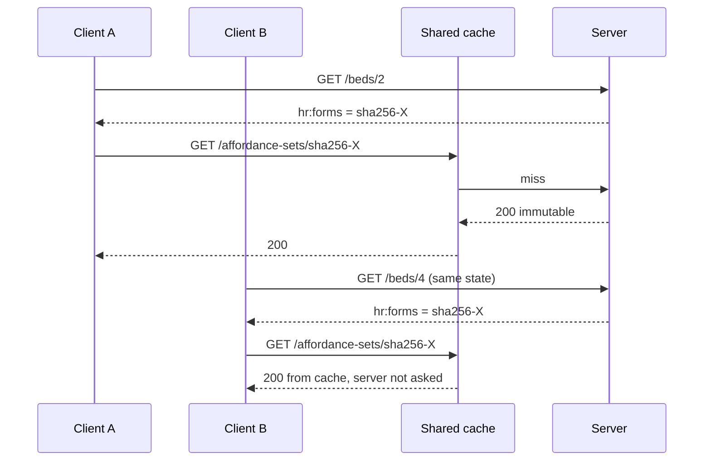

### L4: concurrency and errors

Every act carries the representation's ETag in `If-Match`. The server checks
in a fixed order, and the first failure wins (§6.2):

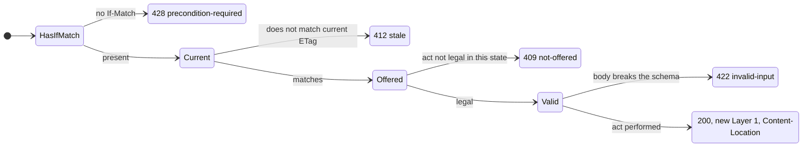

412 means "the world moved; re-read before deciding again", never "retry".
409 means "this was never legal here". A write that loses a race inside the
store is also 412.

### L5: two dialects, one decision

| Dialect | Media type | Rungs | Rendered by |
|---|---|---|---|
| HAL Schema Forms (reference) | `application/hal+json` | L0, L1, L2 | `heart-core` |
| HAL-FORMS (on-ramp) | `application/prs.hal-forms+json` | L0 only | Spring HATEOAS, in `heart-spring` |

The bytes differ; the legal acts and their targets must not.

### L6: reasoning

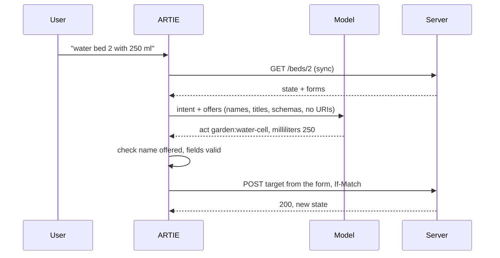

The model's answer can only name an offered act; it cannot express a URI.
L6 is never required: a deterministic client is fully conformant.

## 5. Negotiation

| Request header | Chooses | Response says |
|---|---|---|
| `Accept` | Dialect (media type) | `Content-Type`, `Vary: Accept, …` |
| `Accept-Profile` | Dialect by profile URI, when `Accept` leaves it open | `Link: <…/hal-schema-forms>; rel="profile"` |
| `Prefer: forms=link[, schema=link]` | Rung | `Preference-Applied` (absent at L0) |
| `If-None-Match` | Revalidation | `304` with the same ETag |
| `If-Match` | Which state an act was decided on | `412` if stale |

A Layer 1 ETag names one representation of one state: `"seq-<version>.<dialect>.<rung>"`,
for example `"seq-3.hsf.L2"`. An act repeats the `Accept` and `Prefer` it was
read with, so the server compares against the same representation. `Accept`
that names no dialect is 406, before anything is written.

## 6. The bookmark

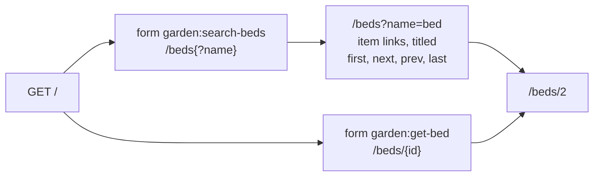

- `GET /` in a dialect is the service index: the search and lookup forms of
  every findable type. Its targets are templates filled from the form's own
  fields (§6.11).
- `GET /` with `Accept: application/json-home` is a JSON Home document whose
  hints declare the dialects, the `Prefer` values honoured up to the cap, and
  that acts need an ETag (§6.11.1).
- Search pages list matches under the IANA `item` relation and page with
  `first`, `last`, `next` and `prev`.
- Every relation (`garden:water-cell`) expands to a descriptor in the ALPS
  profile at `/profiles/garden`.

## 7. Acts and refusals

An act is `POST {target}` with the form's content type, a body that satisfies
the form's schema, and `If-Match`. Success is 200 with the resource's new
Layer 1 and `Content-Location` naming the resource (RFC 9110 §8.7).

Every refusal is an RFC 9457 problem whose `type` names it, so a client never
reads prose to tell them apart:

| Status | `type` (under `…/heart-rise/problems/`) | Extra members |
|---|---|---|
| 428 | `precondition-required` | |
| 412 | `stale` | |
| 409 | `not-offered` | `rel`: the act's relation |
| 422 | `invalid-input` | `violations`: JSON Pointer + message each |

The schema a form shows is generated from the act's input class, and the
body is checked against that same schema, so what is published and what is
enforced cannot differ.

## 8. Why an act is absent

A manifest says what is legal. The `hr:unavailable` link (at L0 in Layer 1;
at L1 and L2 in the set) says why the other acts are not (§6.12):

```json
{"unavailable": [{"rel": "/profiles/garden#sow-seed",
                  "title": "Sow a seed",
                  "reason": "The bed is already planted."}]}
```

It depends on the state alone, so it is content-addressed and shared too.

## 9. One act, end to end

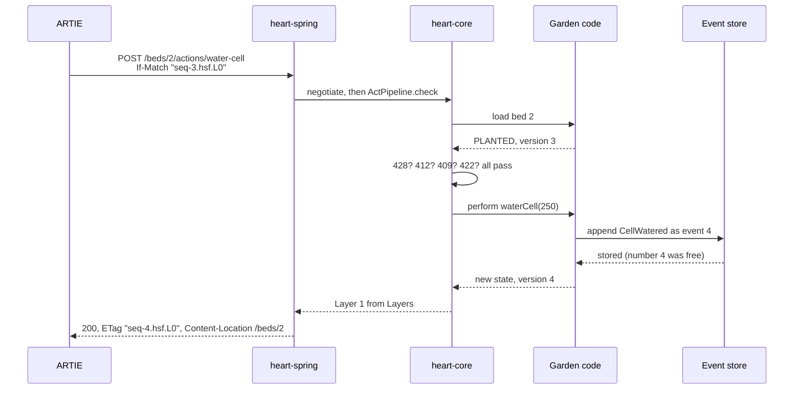

## 10. Core and bindings

HEART's rules are stated without a protocol (§6.0): read, rung, validator,
act, done, stale, not offered, invalid. A binding maps them onto one
protocol. A client picks the binding by the URI's scheme.

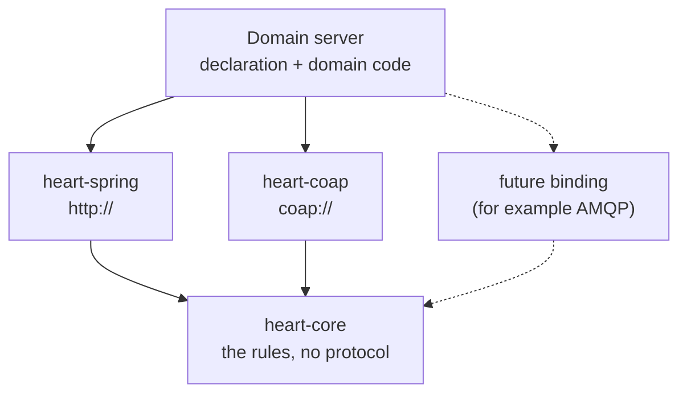

| Concept | HTTP | CoAP |
|---|---|---|
| Read | `GET` | `GET` with option 65003 No-Cache |
| Rung | `Prefer` / `Preference-Applied` | Options 65004 / 65012 |
| Profile | `Accept-Profile` / `Link rel=profile` | Options 65000 / 65008 |
| Validator | ETag | First 8 bytes of SHA-256 over the HTTP ETag |
| Unchanged | 304 | 2.03 Valid |
| Done | 200 | 2.04 Changed |
| Refusals | 428, 412, 409, 422 | 4.00, 4.12, 4.09, 4.22 (same problem types) |
| Dialects | both | HAL Schema Forms only |

The CoAP option and Content-Format numbers are experimental until
registered. No other binding is built yet.

## 11. The library, mapped to all of the above

| Section | Module | Main types |
|---|---|---|
| Declaration (relations, acts, offers) | `heart-core` | `Profile`, `Relation`, `Act`, `Offers`, `StateView`, `Finding`, `ResourceType` |
| 3. The three layers | `heart-core` | `Layers`, `ContentAddress` |
| 4. Rungs | `heart-core` | `Rung`, `ServingLimits` |
| 5. Negotiation | `heart-core`, `heart-spring` | `Negotiation`, `StateETag`, `HttpNegotiation` |
| 6. The bookmark | `heart-core` | `ServiceIndex`, `SearchPages` |
| 7. Acts and refusals | `heart-core` | `InputSchemas`, `BodyCheck`, `ActPipeline`, `Refusals.kt` |
| 8. Why absent | `heart-core` | `Offers.whyAbsent`, rendered by `Layers` |
| HTTP | `heart-spring` | `HeartResourceHandler`, `HeartIndexHandler`, `HeartContentController`, `HttpRefusals` |
| CoAP | `heart-coap` | `CoapRoutes`, `CoapOptions`, `CoapFrontDoor` |
| State as events, past states | `heart-eventsourcing` | `EventSourcing`, `EventStore`, `PostgresEventStore` |
| Proof of conformance | `heart-tck` | `TckFixture`, 13 scenarios |

A server supplies a `HeartResource`: the declaration's `Layers`, plus how to
`load` a resource and `perform` an act, and optionally `find` and `past`.
Everything in this document is then served for it.

## 12. Glossary

| Term | Meaning |
|---|---|
| Affordance set | Layer 2: the forms legal in one state, shared by every resource in it |
| ALPS | Application-Level Profile Semantics: the document that defines each relation |
| Binding | The mapping of HEART's rules onto one protocol |
| Content address | A URL made from the SHA-256 of the body it serves |
| CURIE | Compact URI, such as `garden:water-cell` for `/profiles/garden#water-cell` |
| Dialect | HAL Schema Forms or HAL-FORMS |
| Manifest | The forms in one representation: what is legal now |
| Offer key | The part of a state that decides which acts are offered |
| Rung | How much of a representation is split into cached layers (L0–L2), or a property shown (L3–L6) |
| SRI | Subresource Integrity: the digest a link carries for the bytes it points to |
| TCK | The conformance features every server runs against itself |
