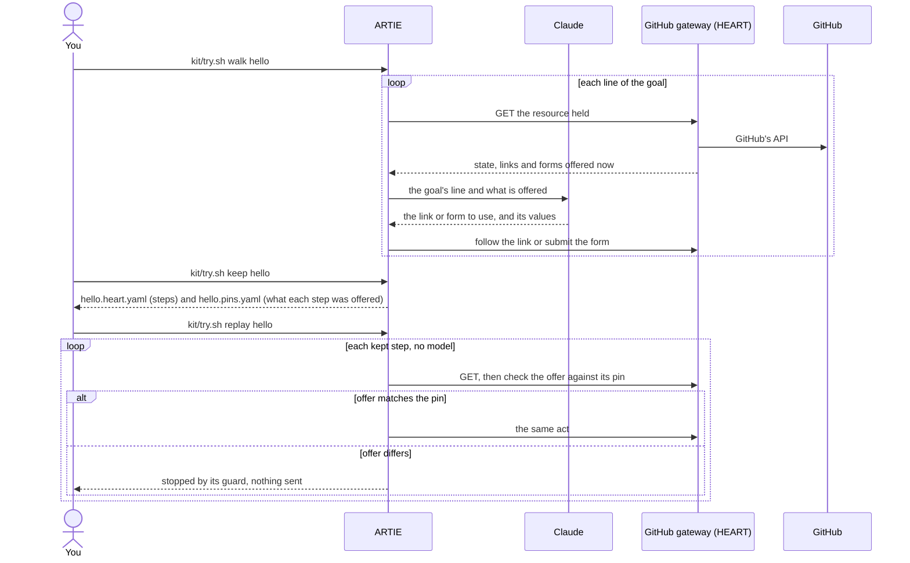
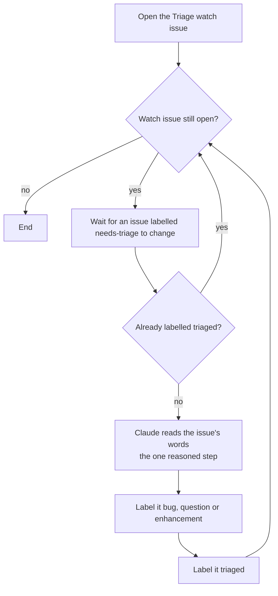
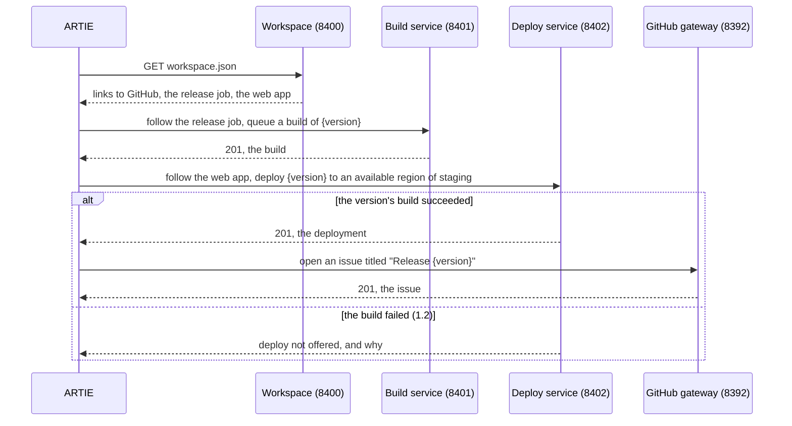
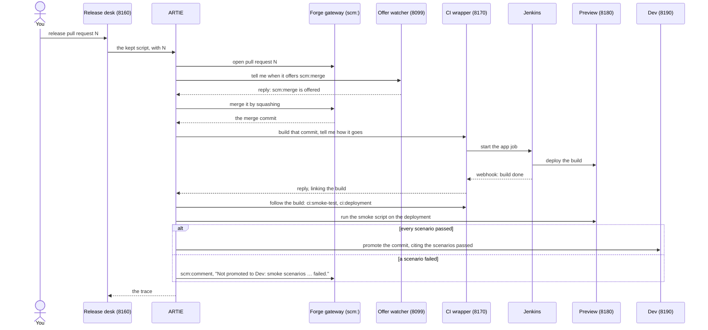
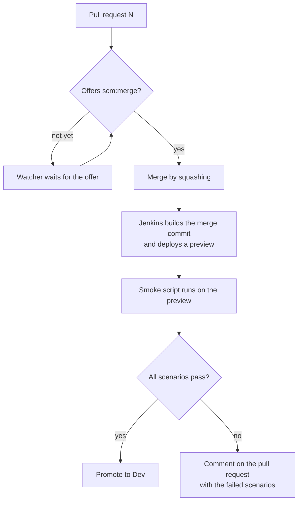
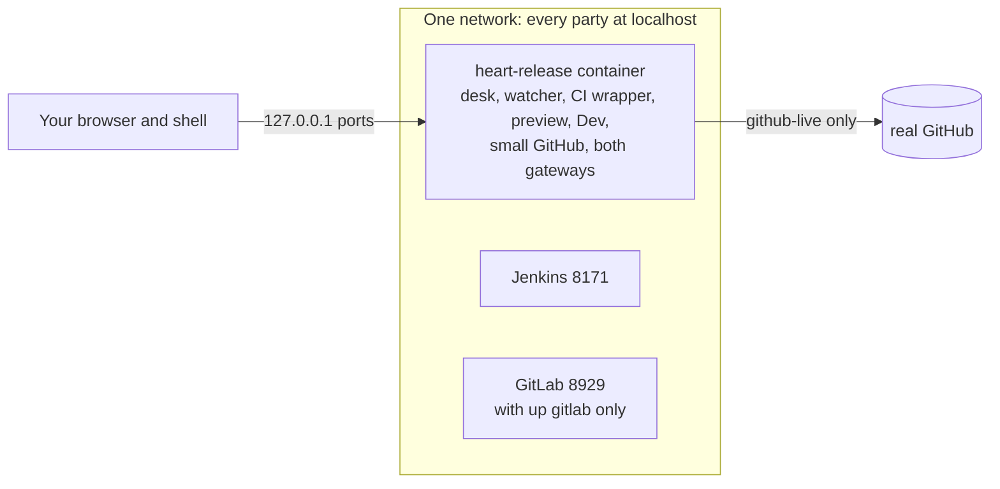

# Try ARTIE on your own GitHub

ARTIE is a generic client for HEART, the way a browser is a generic client for HTML.

- Claude walks a goal written in plain words once.
- ARTIE keeps that walk as a script, and the script runs again with no model.
- Everything runs in one Docker container on your machine, on an empty GitHub repository of yours, with your own
  token.

<details>
<summary>Diagram: walk once, keep, replay with no model</summary>



</details>

## You need

- A Mac or Linux machine with git, and Docker Desktop running.
- A GitHub account.
- An Anthropic API key (console.anthropic.com).

### On Windows

Use WSL 2 with Ubuntu, and do everything below inside Ubuntu, not in PowerShell:

- **Clone inside Ubuntu**, in your home folder (`cd ~`), with Ubuntu's own git.
  - A clone under `/mnt/c` is slow to build from.
  - A clone made by Git for Windows may not run.
- **Docker**, one of:
  - Docker Desktop with WSL integration turned on for your Ubuntu (Settings, Resources, WSL integration).
  - Docker inside Ubuntu: `sudo apt install docker.io docker-buildx docker-compose-v2`, then
    `sudo usermod -aG docker $USER`, and open a new terminal. Without `docker-buildx` the build stops with "the
    --mount option requires BuildKit".
- **Memory** for WSL is set in `%UserProfile%\.wslconfig` (`[wsl2]`, `memory=8GB`), not in Docker Desktop.

## Set up, once

1. **On GitHub, create an empty repository**, named `kit-trial` say. Leave everything as it is: no README, no
   template.
2. **Create a token** at https://github.com/settings/personal-access-tokens/new
   - Repository access: **Only select repositories**, and pick `kit-trial`.
   - Permissions, Repository: **Issues**, **Pull requests** and **Contents**, each **Read and write**.
3. **Clone this repository and put your keys in `kit/.env`:**
   ```sh
   git clone --branch claude/auth-branch-4bnmhc https://github.com/JogoShugh/heart-rise-artie.git
   cd heart-rise-artie
   cp kit/env.example kit/.env
   ```
   Edit `kit/.env`:
   - `OWNER`: your GitHub user name.
   - `REPO`: `kit-trial`.
   - `GITHUB_TOKEN` and `ANTHROPIC_API_KEY`.

   Git ignores this file, and the kit's image never holds it.
4. **Bootstrap:**
   ```sh
   kit/bootstrap.sh
   ```
   The first run builds the kit, which takes a few minutes. Then six issues appear in `kit-trial`.

## Run

Each line is one goal, walked by Claude, live, on `kit-trial`:

```sh
kit/try.sh walk hello                  # opens an issue, comments on it, closes it
kit/try.sh walk triage                 # labels the three issues marked needs-triage
kit/try.sh walk closeout version=1.0   # closes the three marked ready-to-close, each its own way
kit/try.sh walk release version=1.1    # queues a build, deploys it, records the release on GitHub
```

`triage` and `closeout` keep watching until you stop them:

- Each opens an issue named "Triage watch" or "Close-out watch".
- When the issues it works on are done, close that watch issue on GitHub.
- The command ends a few seconds later.

Keep a walk as a script, and replay it with no model:

```sh
kit/try.sh keep release
kit/try.sh replay release version=1.0
```

## What you see

- **On GitHub**, in `kit-trial`: every issue, label, comment and close, made by your account.
- **On your machine**, `work/runs/NAME/run.html`: every request and answer of each run. Open it in a browser.
- **The kept scripts**, `work/NAME.heart.yaml` and `work/NAME.pins.yaml`: the steps, and what each step was offered.

---

## The goals

| Goal | What it does |
|---|---|
| `seed` | What the bootstrap ran: six issues, three labelled `needs-triage` (one also `documentation`), three `ready-to-close` with one of `shipped`, `wontfix` or `duplicate`. Kept as `seed.heart.yaml`, so it runs with no model. |
| `hello` | Opens an issue, comments on it and closes it as completed. |
| `triage` | A watch. Each issue with `needs-triage` gets one label, `bug`, `question` or `enhancement`, chosen by Claude from the issue's words, and then `triaged`. That one step is marked `reasoned`: a replay still asks Claude there and pins everything else. |
| `closeout` | A watch. Each issue labelled `ready-to-close` is closed the way its labels say: `shipped` as completed, with a comment naming the release; `wontfix` as not planned; `duplicate` as a duplicate. Give `version=`. |
| `release` | Across three systems that know nothing of each other: queues a build of the release job on the build service, deploys the release to staging on the deploy service, and records it on GitHub. Give `version=`: 1.0 and 1.1 succeeded; 1.2 failed, so the deploy service doesn't offer it. |

- To replay `triage` or `closeout`, run `kit/bootstrap.sh` again first, so there are new issues for them.
- `kit/try.sh plan NAME` reads and checks a goal and sends nothing.

<details>
<summary>Diagram: how the <code>triage</code> watch decides each issue</summary>



</details>

## Across systems

Beside the GitHub gateway (port 8392), the container runs two more HEART services, simulated and held in memory:

- a build service (8401), a narrow Jenkins;
- a deploy service (8402), a narrow cloud.

How `release` crosses them:

- It starts from the workspace, `http://localhost:8400/workspace.json`, a plain resource that links to GitHub, the
  release job and the web app.
- Crossing from one system to another is following a link.
- Each system gets only its own credential: your token goes to GitHub alone.

<details>
<summary>Diagram: the <code>release</code> goal across three systems</summary>



</details>

## Watch it in a browser

```sh
kit/try.sh up      # the systems keep running, and keep their state, until kit/try.sh down
```

While the kit is up:

- Each command runs in it.
- Each system answers a browser on your machine (`127.0.0.1` only) with HTML: its state, a button for each act it
  offers now, and a greyed one, saying why, for each it won't.
- The addresses are printed. `KIT_PORTS="18392 18400 18401 18402"` moves them (gateway, workspace, build, deploy).
- A browser has to send each system its credential as `Authorization: Bearer …`:
  - your GitHub token to the gateway;
  - `build-token` and `deploy-token` to the build and deploy services.

## The release: GitHub or GitLab, Jenkins, and Dev

A larger trial, beside the goals above. A pull request for Riverside Public Library's renewal policy is:

1. watched until it can merge;
2. merged;
3. built by a real Jenkins;
4. smoke-tested at the preview Jenkins deployed;
5. promoted to Dev, or, when the smoke test fails, left out of Dev, with a comment on the pull request saying why.

What makes it work:

- One kept script does it every time, with no model. Only the pull request changes.
- The forge is GitHub or GitLab: the script asks for `scm:` relations, which the gateway serves over either.
- Every party speaks HEART.

```sh
kit/release.sh up              # builds the parties and Jenkins, and starts them (the first time, a few minutes)
kit/release.sh run github      # five pull requests at a small GitHub inside the kit
kit/release.sh up gitlab       # GitLab too: about 4 GB more memory, several minutes the first time
kit/release.sh run gitlab      # the same five as GitLab merge requests
kit/release.sh run github-live # the same five at OWNER/REPO on real GitHub
kit/release.sh down
```

What to expect:

- Of the five, four are promoted to Dev.
- The fifth, "Renewals: none during the audit", fails the smoke test's renewal scenario and stays out.
- Each release's trace is in `work/runs/SCM/pr-N.yaml`.

About `run github-live`:

- It pushes `library/main` and `library/pr-501` to `library/pr-505` to your repository.
- It opens, merges and comments on pull requests between them. Your own `main` is never touched.
- It needs `OWNER`, `REPO` and `GITHUB_TOKEN` in `kit/.env`.

What answers a browser on this machine:

- While it is up: Jenkins on http://localhost:8171/ (user `artie`, the password in
  `exhibits/merge-watch-release/jenkins/jenkins.env.example`), and GitLab on http://localhost:8929/.
- While a release runs: the release desk (http://localhost:8160/) and Dev (http://localhost:8190/). Each release
  starts its parties afresh.

On Linux and in WSL, Docker needs its Compose plugin: `sudo apt install docker-compose-v2`.

<details>
<summary>Diagram: one release, from pull request to Dev</summary>



</details>

<details>
<summary>Diagram: the release's decisions</summary>



</details>

<details>
<summary>Diagram: what runs where in <code>kit/release.sh</code></summary>



</details>

## Write your own

Copy a goal in `./work` and change its words:

- A line is one step.
- A step with sub-steps works inside the resource it led to.
- `` `as name` `` keeps that resource for later lines, read as `{name}` or `{name.number}`.
- The full syntax is in `client/README.md`.
- The GitHub gateway offers issues, pull requests, branches, commits to a branch, comments and labels, and nothing
  else of GitHub's API.

## Another repository

- `OWNER` and `REPO` name any repository your token can write to.
- A fork of this one works too: turn its issues on first, since a new fork has them off.
- With both unset, the bootstrap takes your fork from git's origin.

## When something stops

- **A walk stopped partway.** Claude finds the way afresh each walk, and now and then stops.
  - Close the watch issue it opened, if any ("Triage watch", "Close-out watch"), and walk the goal again.
  - A replay of a kept script runs the same way every time.
- **`missing input: …`**: give it as `name=value` after the goal's name.
- **`stopped … by its guard`**: the replay found a form that differs from the pins, and sent nothing. Walk the goal
  again and keep it, or replay with `--guard lenient`.
- **`GITHUB_TOKEN can't read …`**: check `OWNER`, `REPO`, and that the token was given that repository.
- **The build is killed**: give Docker more memory, in Docker Desktop's Settings, under Resources (on Windows, in
  `.wslconfig`).
- The gateway's log is `work/runs/gateway.log`.

## Known limits

- The kept `release` script reads the deploy region from the app's state, and marks that value for review.
- A `release` replay refused at the deploy has queued its build already.
- A browser sign-in for the build and deploy services is still to come.

The trial these goals were run in, with every run's output: `exhibits/kit-trial/`.
