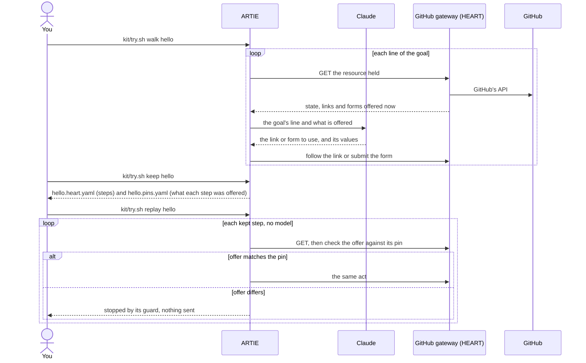
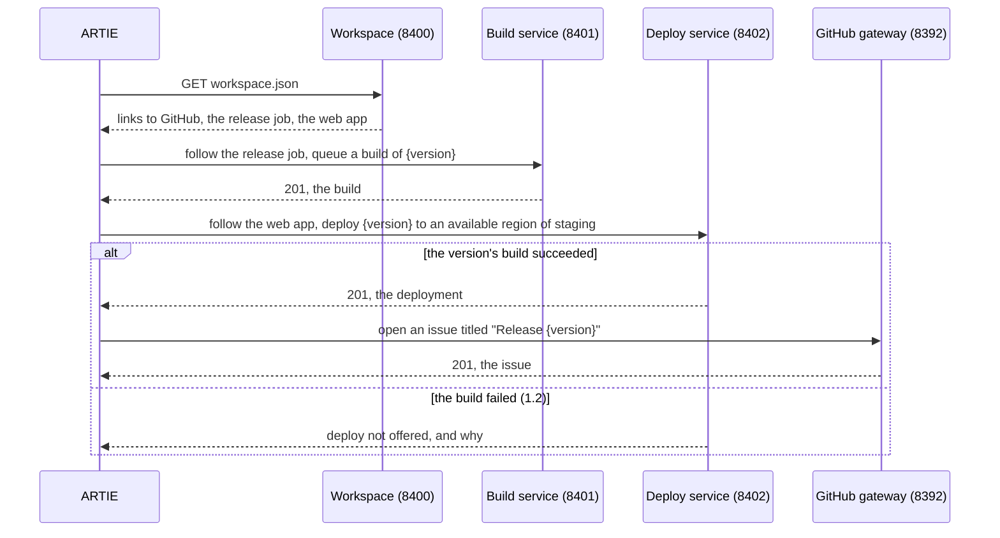
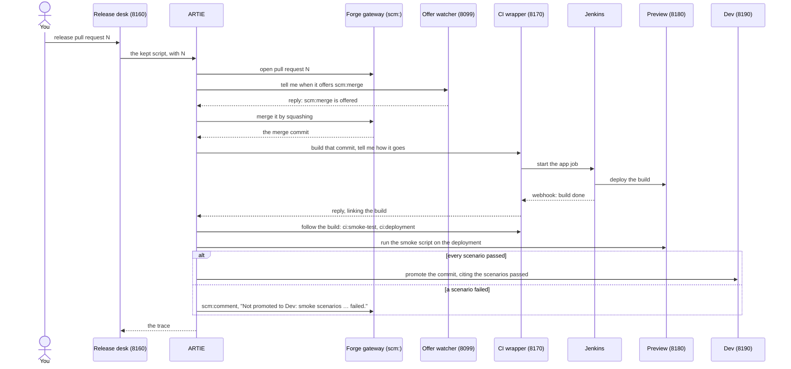

# The ARTIE Kit

ARTIE is a generic client for HEART, the way a browser is a generic client for HTML.

- Claude walks a goal written in plain words once.
- ARTIE keeps that walk as a script. The script runs again with no model.
- Everything runs in Docker on your machine.

## Quickstart

Needs git, and Docker running with 10 GB of memory (6 GB with `USE_GITLAB=no`). No account, no key, no model.

```sh
git clone https://github.com/JogoShugh/heart-rise-artie.git
cd heart-rise-artie
```

**1. Kept scripts at a small GitHub**

```sh
kit/try.sh tour
```

Expected (the first run builds for a few minutes):

```
seed: six issues, three waiting for triage and three ready to close
finished, 15 steps; acted: github:repos-get 1, github:open-issue 6

hello: open an issue, comment on it, close it
finished, 12 steps; acted: github:repos-get 1, github:open-issue 1, github:issues-get 1, github:comment 1, github:close 1

closeout: …
finished, 34 steps; acted: … github:close 1, github:close-not-planned 1, github:close-duplicate 1

release: queue a build, deploy it to staging, record it on GitHub
finished, 16 steps; acted: ci:build 1, cd:deploy 1, github:repos-get 1, github:open-issue 1
```

**2. The release at real Jenkins and GitLab**

```sh
kit/release.sh up gitlab
kit/release.sh run gitlab
```

Expected (GitLab takes several minutes the first time):

```
waiting for Jenkins... up at http://localhost:8171
waiting for GitLab (several minutes the first time)...... up at http://localhost:8929
…
pr-501: promoted to Dev at "…"
pr-502: promoted to Dev at "…"
pr-503: promoted to Dev at "…"
pr-504: not promoted to Dev
pr-505: promoted to Dev at "…"
Each release's trace: work/runs/gitlab/pr-N.yaml
```

- At the small GitHub instead: `kit/release.sh run github`.

**3. Look, then stop**

```sh
open work/runs/hello-kept/index.html   # every request and answer
kit/try.sh down
kit/release.sh down
```

## Setup Script

- `kit/setup.sh` does the quickstart and asks about each option.
- Windows, in PowerShell (installs WSL and Ubuntu if needed, clones inside Ubuntu, carries on there):
  ```powershell
  irm https://raw.githubusercontent.com/JogoShugh/heart-rise-artie/main/kit/windows/setup.ps1 | iex
  ```
- Options, in `kit/.env` (`cp kit/env.example kit/.env`):
  - `USE_GITLAB`: GitLab for the release. Setup suggests yes. Needs about 4 GB more memory.
  - `USE_GITHUB`: replay at your repository on real GitHub. Setup suggests no.
  - `USE_ANTHROPIC`: Claude walks goals, billed to your key. Setup suggests no. Triage needs it.
- Each option takes one of these values:
  - `ask` (default): setup asks.
  - `yes`: setup uses it and asks only for missing values.
  - `no`: setup leaves it off.
- Setup writes each option you choose back as `yes`.
- A pasted key shows one `*` per character, then its length and last four.

## Windows by Hand

- Use WSL 2 with Ubuntu. Run everything inside Ubuntu, not PowerShell.
- Clone in Ubuntu's home (`cd ~`) with Ubuntu's git:
  - a clone under `/mnt/c` builds slowly;
  - a clone made by Git for Windows may not run.
- Docker, either:
  - Docker Desktop, with WSL integration on for your Ubuntu (Settings, Resources, WSL integration);
  - Docker in Ubuntu: `sudo apt install docker.io docker-buildx docker-compose-v2`, `sudo usermod -aG docker $USER`, new terminal.
- Without `docker-buildx` the build stops with "the --mount option requires BuildKit".
- Memory: `%UserProfile%\.wslconfig`, `[wsl2]` `memory=12GB`. Not Docker Desktop's setting.

## Your Own GitHub (Optional)

1. Create an empty repository, say `kit-trial`: no README, no template.
2. Create a token at https://github.com/settings/personal-access-tokens/new:
   - Repository access: **Only select repositories**, `kit-trial`.
   - Repository permissions: **Issues**, **Pull requests**, **Contents**, each **Read and write**.
3. In `kit/.env`:
   - `OWNER`: your GitHub user name.
   - `REPO=kit-trial`.
   - `GITHUB_TOKEN`, `USE_GITHUB=yes`.
   - `ANTHROPIC_API_KEY`, `USE_ANTHROPIC=yes`, for Claude's walks.
4. Run `kit/bootstrap.sh`. Six issues appear in `kit-trial`.

- Git ignores `kit/.env`. The image never holds it.
- `OWNER`/`REPO` can name any repository the token can write to.
- A fork works too. Turn its issues on first: a new fork has them off.
- With both unset, bootstrap takes your fork from git's origin.

## Commands

No model:

```sh
kit/try.sh tour                          # seed, hello, closeout, release
kit/try.sh replay hello                  # open an issue, comment, close
kit/try.sh replay closeout version=1.0   # close the three ready-to-close
kit/try.sh replay release version=1.1    # build, deploy, record on GitHub
kit/try.sh up                            # keep the kit running between commands
kit/try.sh reset                         # small GitHub and services as first started
kit/try.sh down
kit/try.sh plan NAME                     # read and check a goal, send nothing
```

With an Anthropic key:

```sh
kit/try.sh walk hello
kit/try.sh walk triage                   # label the three needs-triage issues
kit/try.sh walk closeout version=1.0
kit/try.sh walk release version=1.1
kit/try.sh keep release                  # keep the walk as a script
kit/try.sh replay release version=1.0    # replay it, no model
```

- Pins: `NAME.sim.pins.yaml` at the small GitHub, `NAME.pins.yaml` on real GitHub.
- The small GitHub's state lasts until `down` or `reset`.
- `triage` and `closeout` are watches: each opens a "Triage watch" or "Close-out watch" issue.
  - End one: `kit/try.sh stop triage` (or `closeout`), or close that issue on GitHub.
  - The command ends a few seconds later.
- Before replaying `triage` or `closeout` on real GitHub, run `kit/bootstrap.sh` again for fresh issues.

<details>
<summary>Diagram: walk once, keep, replay with no model</summary>



</details>

## Output

- On GitHub: every issue, label, comment and close.
- `work/runs/NAME/run.html`: every request and answer of a run.
- `work/NAME.heart.yaml`, `work/NAME.pins.yaml`: kept steps, and what each step was offered.

## Goals

- `seed`: six issues. Three `needs-triage` (one also `documentation`). Three `ready-to-close`, with `shipped`, `wontfix` or `duplicate`.
- `hello`: open an issue, comment, close as completed.
- `triage` (watch): label each `needs-triage` issue `bug`, `question` or `enhancement`, then `triaged`.
  - Claude picks the label from the issue's words.
  - That step is `reasoned`, so a replay still asks Claude there.
- `closeout` (watch, `version=`): close each `ready-to-close` issue as its labels say:
  - `shipped`: completed, with a comment naming the release;
  - `wontfix`: not planned;
  - `duplicate`: duplicate.
- `release` (`version=`): queue a build, deploy to staging, record on GitHub.
  - 1.0 and 1.1 built fine.
  - 1.2 failed, so the deploy service won't offer it.

## Across Systems

- Ports:
  - 8392: GitHub gateway;
  - 8400: workspace, `workspace.json`, which links to GitHub, the release job and the web app;
  - 8401: build service, a narrow Jenkins (simulated);
  - 8402: deploy service, a narrow cloud (simulated).
- Crossing systems means following a link.
- Each system gets only its own credential:
  - the gateway: your GitHub token, or `github-token` at the small GitHub;
  - build: `build-token`;
  - deploy: `deploy-token`.
- While `kit/try.sh up`:
  - each system serves HTML to a browser on `127.0.0.1`;
  - offered acts show as buttons; refused ones are greyed, with the reason;
  - send `Authorization: Bearer …`;
  - `KIT_PORTS="18392 18400 18401 18402"` moves the ports.

<details>
<summary>Diagram: the <code>release</code> goal across three systems</summary>



</details>

## The Release: GitHub or GitLab, Jenkins, Dev

A Riverside Public Library pull request goes through five steps:

1. Watch it until it can merge.
2. Merge it by squashing.
3. Build it on real Jenkins.
4. Smoke-test the preview that Jenkins deployed.
5. Promote it to Dev. If the smoke test fails, leave it out and comment why.

- One kept script, no model. Only the pull request changes.
- Forge: GitHub or GitLab, through `scm:` relations, which the gateway serves for both.

```sh
kit/release.sh up              # parties and Jenkins (first time: a few minutes)
kit/release.sh up gitlab       # GitLab too
kit/release.sh run github      # five pull requests at the small GitHub
kit/release.sh run gitlab      # the same five as GitLab merge requests
kit/release.sh run github-live # the same five at OWNER/REPO on real GitHub
kit/release.sh reset [github|gitlab]  # back as first seeded, runs cleared
kit/release.sh shell           # shell in the release container
kit/release.sh down            # GitLab's data is kept
```

- Four of the five reach Dev.
- 504, "Renewals: none during the audit", fails the renewal smoke scenario and stays out.
- Traces: `work/runs/SCM/pr-N.yaml`.
- `run github-live`:
  - needs `OWNER`, `REPO`, `GITHUB_TOKEN` in `kit/.env`;
  - pushes `library/main` and `library/pr-501` to `library/pr-505`;
  - opens, merges and comments on pull requests between them;
  - never touches your `main`.
- Browser addresses:
  - Jenkins, http://localhost:8171/: user `artie`, password in `exhibits/merge-watch-release/jenkins/jenkins.env.example`;
  - GitLab, http://localhost:8929/;
  - while a release runs: desk http://localhost:8160/, Dev http://localhost:8190/.
- Linux and WSL need `sudo apt install docker-compose-v2`.
- Containers: `heart-release` (desk, watcher, CI wrapper, preview, Dev, small GitHub, both gateways), Jenkins and GitLab, on one network.

<details>
<summary>Diagram: one release, from pull request to Dev</summary>



</details>

## Write Your Own

- Copy a goal in `./work` and change its words.
- One line = one step.
- Sub-steps work inside the resource their step led to.
- `` `as name` `` keeps a resource for later lines, as `{name}` or `{name.number}`.
- Full syntax: `client/README.md`.
- The gateway offers only issues, pull requests, branches, commits to a branch, comments and labels.

## Troubleshooting

- **A walk stopped partway**: Claude finds the way afresh each walk, and sometimes stops.
  - Close any watch issue it opened, then walk again.
  - Replays run the same way every time.
- **`missing input: …`**: add `name=value` after the goal's name.
- **`stopped … by its guard`**: a form differs from its pin, and nothing was sent.
  - Walk and keep again, or replay with `--guard lenient`.
- **`GITHUB_TOKEN can't read …`**: check `OWNER`, `REPO`, and that the token was given that repository.
- **Build killed**: give Docker more memory (Docker Desktop: Settings, Resources; Windows: `.wslconfig`).
- Gateway log: `work/runs/gateway.log`.

## Known Limits

- Kept `release` reads the deploy region from the app's state, and marks that value for review.
- A `release` replay refused at the deploy has already queued its build.
- No browser sign-in yet for the build and deploy services.
- `kit/release.sh run` replays the release unguarded: the release desk never loads `release.pins.yaml`, so a changed form would not stop it.
  - `exhibits/merge-watch-release/release.pins.yaml` predates the watcher and Jenkins wrapper taking requests with no reply, so a guarded `artie run` of it would stop.
  - Fix: the desk holds the script to its pins; then re-pin from a fresh walk.

Trial runs and their output: `exhibits/kit-trial/`.
