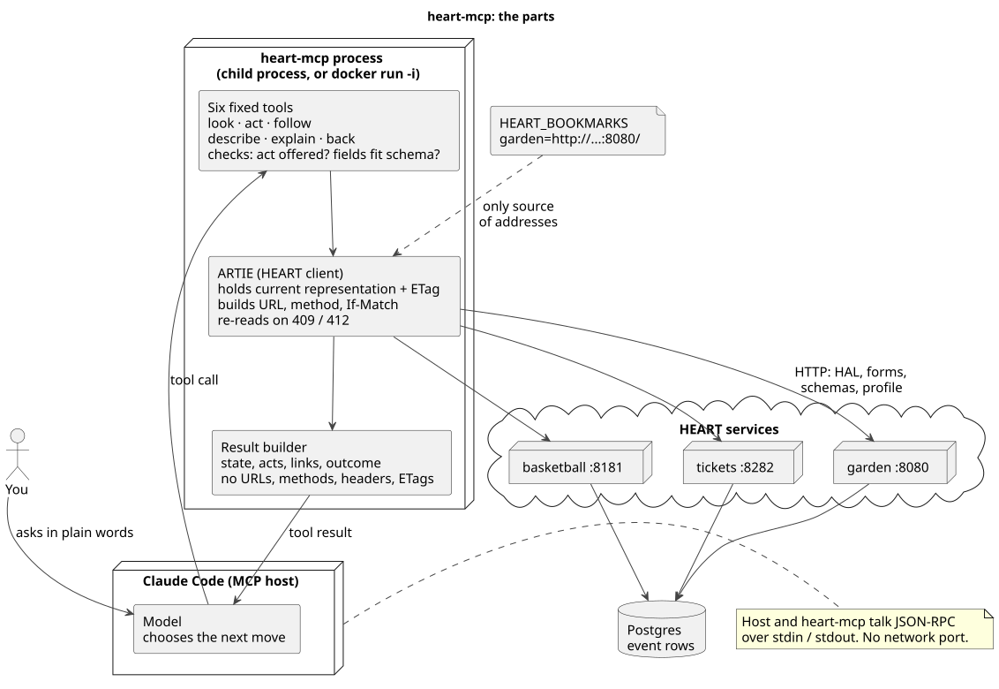
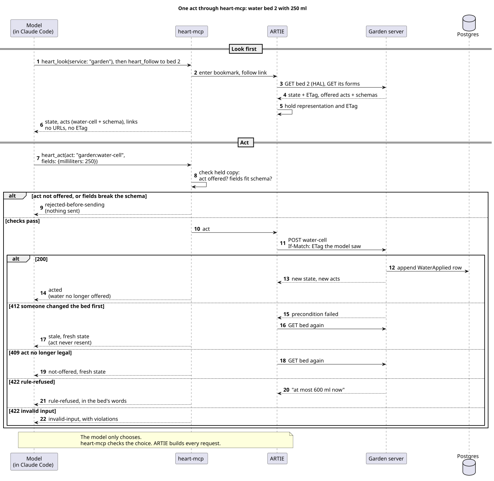

# How heart-mcp works

heart-mcp lets any MCP host, such as Claude Code, work any HEART service through six fixed tools:

- The model chooses the next move.
- heart-mcp checks the choice.
- ARTIE builds every request.

The diagrams are also published at <https://claude.ai/artifact/PUUtJc2uu59NQFTZJPdrD3>. The evidence that it works is in [../PROOF.md](../PROOF.md).

## The parts



There are four parts:

1. **Claude Code**, the MCP host. It runs the model, and the model decides what to do.
2. **heart-mcp**, a small Java program that Claude Code starts. It's the MCP server.
3. **ARTIE**, the HEART client library inside heart-mcp. It does all the HTTP work.
4. **A HEART service**, such as the garden server on port 8080.

The model talks only to heart-mcp. It never talks to the service directly.

### How the host and heart-mcp talk

Claude Code starts heart-mcp as a child process, either directly or with `docker run -i`. They exchange JSON-RPC messages over stdin and stdout, one JSON line per message. There's no network port between them.

At startup:

1. Claude Code sends `initialize`. heart-mcp answers with its name and protocol version 2025-06-18.
2. Claude Code asks for `tools/list`. heart-mcp answers with the six tools.
3. Claude Code gives the model those six tool descriptions.

The `HEART_BOOKMARKS` environment variable tells heart-mcp which services exist, for example `garden=http://host.docker.internal:8080/`. It's the only source of addresses.

### The six tools never change

The model gets the same six tools every time, like the buttons of a browser:

| Tool | What it does |
|---|---|
| `heart_look` | Goes to a bookmark, or reads the current resource again. |
| `heart_act` | Takes one offered act, by name, with fields. |
| `heart_follow` | Follows a link, by its rel and title. |
| `heart_describe` | Returns the service's longer description of an act. |
| `heart_explain` | Returns the service's reason an act isn't offered now. |
| `heart_back` | Goes back one resource. |

What changes is the answer each tool gives.

### One look, step by step

Say the model calls `heart_look` with service `garden`:

1. heart-mcp passes the call to ARTIE.
2. ARTIE GETs the garden's root resource as HAL. Then it follows the forms link to get the acts and their JSON Schemas.
3. ARTIE checks integrity, and holds the representation and its ETag in memory. That held copy is the session's state.
4. heart-mcp turns it into a result with three parts:
   - the resource's state;
   - the offered acts, each with a name, title, description and schema;
   - the links, each with a rel and title.
5. heart-mcp leaves out every URL, method, header and ETag before the model sees anything.

The model reads that result and picks the next move.

## One act



Say the model calls `heart_act` with `garden:water-cell` and 250 ml.

First, heart-mcp checks the held copy:

1. Is the act in the list of offered acts? If not, nothing is sent, and the outcome is `rejected-before-sending`.
2. Do the fields fit the act's schema? 2000 ml is over the maximum of 1000, so nothing is sent, with the same outcome.

If both checks pass, ARTIE builds the request itself:

- the act's URL;
- POST;
- `If-Match`, carrying the ETag of the representation the model saw.

ARTIE doesn't read the resource again first, so the model acts on what it actually saw.

The server's answer becomes one outcome:

| Server answer | Outcome | What happens |
|---|---|---|
| 200 | `acted` | The new state and the new acts come back. Watering is no longer offered. |
| 412 | `stale` | Someone else changed the bed first. ARTIE reads it again and drops the act. It never resends it. |
| 409 | `not-offered` | The act is no longer legal. ARTIE reads the bed again. |
| 422 `rule-refused` | `rule-refused` | The fields were valid, but a rule of the bed said no, in its own words: "at most 600 ml now". |
| 422 `invalid-input` | `invalid-input` | The server rejected the fields, and lists the violations. |

## Why this is safe

- The model can't type an address: no tool takes a URL.
- The model can't take an act that the resource doesn't offer right now.
- The model can't leave out `If-Match`, because ARTIE always adds it.

The model does the reasoning, and ordinary code does the exact HTTP.

## Why it works on services it has never seen

heart-mcp knows nothing about gardens, games or tickets. Every HEART service describes itself the same way:

- HAL links;
- a forms link with JSON Schemas;
- an ALPS profile with descriptions.

ARTIE reads that pattern. So a new service needs only a new bookmark. The same image worked the garden, basketball and tickets services with no code changes.

## Docker

The Docker image is only packaging: Java and heart-mcp together. Inside the container, `localhost` is the container itself. So a service running on your machine is reached as `host.docker.internal`.

## Limits today

- **stdio only:** there's no HTTP transport and no auth, so it's one local user per process.
- **State in memory:** the held state lives in that one process, and it's lost when the process ends.
- **Test coverage:** the 12 automated scenarios cover only the garden. Basketball and tickets are shown only by Claude Code runs.

## Diagram sources

The diagrams are PlantUML: [heart-mcp-parts.puml](heart-mcp-parts.puml) and [heart-mcp-act.puml](heart-mcp-act.puml). To redraw them as SVG:

```sh
java -jar plantuml.jar -tsvg mcp/docs/*.puml
```
