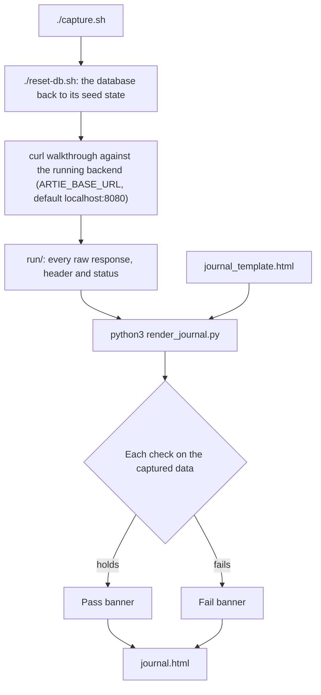

# Living documentation for spring-artie-backend

Regenerates `journal.html` fresh from a real, live-captured run — not a
static document. Two scripts, one honest split between them:

- **`capture.sh`**
  - Resets the database to a known seed state.
  - Runs the real HTTP walkthrough against your running backend.
  - Saves every raw response/header/status to `run/`.
  - This is the only part that touches the network.
- **`render_journal.py`**
  - Reads `run/` and fills `journal_template.html` with the real captured data.
  - Computes genuine pass/fail verdicts by inspecting that data (hash comparisons, boolean field checks, status code
    checks) — not narrated assumptions.

<details>
<summary>Diagram: capture, then render</summary>



</details>

## What's actually dynamic vs. fixed, stated plainly

- **The narrative prose** (what each entry explains, why the design works) is fixed.
  - Written once, describing the system's design, which doesn't change between runs.
  - This can't and doesn't regenerate itself from the data; that would require understanding the design fresh each
    time, not just reading numbers off it.
- **The embedded data** (every YAML block, every hash, every href) is read fresh from `run/` on every render —
  whatever `capture.sh` actually captured on this run.
- **The verdict banners** are computed, not asserted.
  - The cross-bed proof genuinely string-compares two captured hashes and will render a real fail banner if they
    don't match — same for the readOnly regression check and the three status-code checks.
  - Verified during development by feeding the renderer deliberately broken sample data and confirming it actually
    flipped to a fail banner, then fixing the sample data and confirming it flipped back — this isn't hardcoded to
    always say "correct."

## Running it

```bash
cd spring-artie-backend   # where docker-compose.yml lives
./capture.sh              # hits the live backend, writes run/
python3 render_journal.py # reads run/, writes journal.html
open journal.html         # or just double-click it
```

## Extending it

Each entry in `render_journal.py` is a small Python function (`entry_00()` through `entry_06()`) that reads specific
files from `run/`, computes a verdict, and returns an HTML fragment.

Adding a new check means:

1. Capture the relevant response in `capture.sh`.
2. Read it in a new or existing entry function.
3. Write a real comparison — not a new hardcoded "Correct" string.
