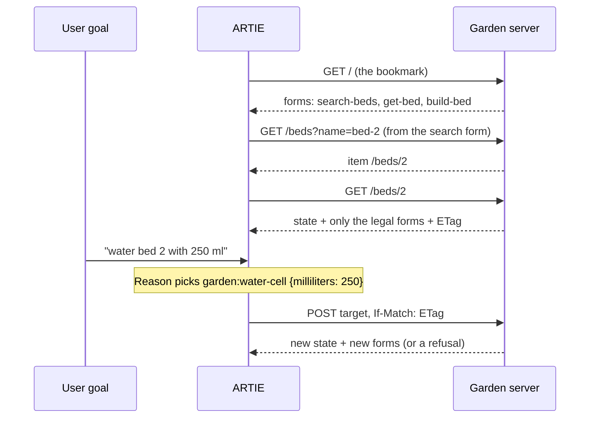

# From the Web to HEART

*A beginner's walk-through · H.E.A.R.T. 0.5 draft · garden example*

This walk-through covers three things:

- how the browser learned to work any website without knowing it in advance;
- how JSON APIs lost that ability;
- how HEART gives it back, so an AI agent can use a service the way a person uses a website.

Then it takes one plain data API and changes it, step by step, until it speaks HEART's profile of HAL Schema Forms.

This is the Markdown version of [`FROM-WEB-TO-HEART.html`](FROM-WEB-TO-HEART.html), which is also published at
<https://claude.ai/artifact/JmRxGm7vJPyPuLdPeMy146>.

**Contents**

1. [The landscape](#1-the-landscape)
2. [Evolving one API](#2-evolving-one-api)
3. [The agent's loop](#3-the-agents-loop)
4. [Checklist: from data API to HEART](#4-checklist-from-data-api-to-heart)

---

## 1. The landscape

Every example below talks to the same thing: a **garden bed**. You can:

- sow a seed in an empty bed;
- water a planted bed;
- harvest a bed when it's ready.

What you're allowed to do depends on the bed's state right now. That last sentence is the whole story.

### 1989–1995 · The Web: a client that knows nothing about the site

Tim Berners-Lee combined three things:

- **URIs** to name resources;
- **HTTP** to transfer them;
- **HTML** to represent them.

HTML carries the data and also the controls: links to follow and forms to fill in. A browser knows HTML and nothing about any particular shop or bank. In every response, the site tells the browser what can be done next. When the site changes, nobody reinstalls the browser.

### 2000 · REST names why it works

Roy Fielding's dissertation describes the Web's architecture as **REST**. One of its constraints is "hypermedia as the engine of application state". It means the client moves from state to state only by choosing among the links and forms the server sent. That's what lets clients and servers change independently.

### 2000s–2010s · JSON APIs drop the controls *(a loss)*

Programs started talking to servers in JSON over HTTP, and called it REST. But JSON has no links or forms. So the controls moved out of the response and into documentation:

- which URL to build;
- which method;
- which body;
- which rules apply.

Swagger (2011), later called OpenAPI (2016), made that documentation machine-readable. Clients hard-code the URLs and the rules.

In 2008 Fielding objected: "REST APIs must be hypertext-driven." Leonard Richardson's maturity model (2008) put hypermedia at the top level. Most APIs stopped below it.

### 2011 onward · Hypermedia JSON formats appear

Several formats put links and forms back into JSON:

- **HAL** (Mike Kelly, 2011), for links;
- Siren;
- JSON Hyper-Schema;
- **HAL-FORMS** (Mike Amundsen);
- **HAL Schema Forms**, forms whose fields are JSON Schema.

They worked, but they stayed niche, because developers wrote each client by hand from the docs anyway.

### 2023 onward · AI agents get a catalogue, not a map *(a loss)*

Agents call APIs through tool definitions:

- function calling;
- OpenAPI documents in the prompt;
- tool search;
- the Model Context Protocol (MCP, 2024).

Each one gives the agent a list of what the system can do *in principle*. None says what's allowed for *this* bed *now*. So an agent tries "water bed 1", and only the refusal tells it that nothing is planted.

### 2026 · HEART: the browser's idea, for agents

**H.E.A.R.T.** (Hypermedia Enforced Agentic Reliable Transactions) puts the controls back in the response, scoped to one resource in its current state:

- An agent gets the bed and exactly the acts the bed allows now.
- An act that isn't offered isn't allowed: the absence is the enforcement.
- **ARTIE** is the reference client. An agent built on it can work a garden, a basketball game or a ticket desk with no code about any of them.

### The Web and HEART, side by side

| On the Web | In HEART |
|---|---|
| Browser | ARTIE, a generic client |
| HTML | HAL Schema Forms (`application/hal+json`) with the HEART profile |
| A link | A HAL link, such as `self` or `item` |
| A form and its fields | A form in `_forms`, its fields described by JSON Schema |
| The person choosing what to click | The user's goal, or a language model choosing among the offered acts |
| The home page you bookmarked | The service's bookmark, `/` |
| "This page has expired" on resubmit | `412`: the act was based on a state that has changed |

---

## 2. Evolving one API

We start with an ordinary data API and add one idea at a time. Each step shows what goes on the wire:

- Lines starting with `+` are new in that step.
- The responses come from the reference garden server, trimmed with `…`.

### Step 0 · The starting point: a data API, state only

```http
GET /beds/1   Accept: application/json

HTTP/1.1 200 OK
Content-Type: application/json

{"id":1, "label":"bed-1", "status":"EMPTY", "moistureLevel":0}
```

Everything else lives in a document the client's developer read once:

```text
API docs (out of band)
POST /beds/{id}/sow-seed    body {"seedType":string, "depthCm":1..10}   only if status is EMPTY
POST /beds/{id}/water-cell  body {"milliliters":1..1000}            only if a seed is planted
POST /beds/{id}/harvest     body {}                                 only if READY_TO_HARVEST
```

> **What goes wrong**
>
> - The client builds URLs itself, and copies the rules about status into its own code.
> - When the server changes a rule or a path, the client breaks, or quietly does the wrong thing.
> - An agent given these docs tries acts the bed doesn't allow, and learns the rules by being refused.
> - Two clients acting at once can overwrite each other.

### Step 1 · Adds a hypermedia type and links: say it's HAL, and link instead of documenting

```diff
  GET /beds/1   Accept: application/hal+json
+ Content-Type: application/hal+json

  {"id":1, "label":"bed-1", "status":"EMPTY", "moistureLevel":0,
+  "_links":{"self":{"href":"/beds/1"}}}
```

> **Why**
>
> - The media type tells the client how to read the response, the way `text/html` does for a browser.
> - Addresses now come from the server inside `_links`, so the client stops building them.
> - HAL alone can only say "go there". It can't say "send this".

### Step 2 · Adds forms, only the legal ones: put the acts in the response, with HAL Schema Forms

```diff
  {"id":1, "status":"EMPTY", …,
   "_links":{"self":{"href":"/beds/1"}},
+  "_forms":{
+    "sow-seed":{
+      "_links":{"target":{"href":"/beds/1/actions/sow-seed"}},
+      "method":"POST", "contentType":"application/json",
+      "schema":{"type":"object", "required":["seedType"],
+        "properties":{"seedType":{"type":"string","minLength":1},
+                      "depthCm":{"type":"integer","minimum":1,"maximum":10}}}}}}
```

> **Why**
>
> Each form carries everything needed to act: where to send it, how to send it, and what the body must look like.
>
> The important part is what's *missing*:
>
> - Bed 1 is empty, so it offers only sow-seed.
> - Watering and harvesting aren't in the response, so the client can't even try them.
> - Bed 2, which is planted, would offer water-cell instead.
>
> The rule about status has moved from the client's code into the server's response. At this point, the API is like a website again.

### Step 3 · Adds meaning (relations, a profile, descriptions): name each act so a stranger can understand it

```diff
+ Link: <https://github.com/jogoshugh/heart-rise/hal-schema-forms>; rel="profile"

  {… "_links":{"self":{"href":"/beds/1"},
+    "curies":[{"name":"garden","href":"/profiles/garden#{rel}","templated":true}]},
   "_forms":{
+    "garden:sow-seed":{
+      "title":"Sow a seed",
+      "description":"Plants a seed in an empty bed. The bed becomes planted.",
       …
       "schema":{… "seedType":{"type":"string",
+        "title":"Seed", "description":"The kind of seed to sow", "examples":["basil"]} …}}}}
```

> **Why**
>
> - The `profile` link tells the client that this response follows HEART's profile of HAL Schema Forms, so it may rely on the profile's rules.
> - The form's name is now a **link relation**:
>   - `garden:sow-seed` is a short form (a CURIE) of `/profiles/garden#sow-seed`.
>   - That address describes the act in an ALPS profile.
>   - The client learns the CURIE and the profile from the response itself, during the interaction.
> - Titles, descriptions and examples are written for whoever chooses: a person, or a language model.

### Step 4 · Adds safe acts (validators and clear refusals): act only on the state you saw

```diff
  GET /beds/1
+ ETag: "seq-0.hsf.L0"
+ Cache-Control: no-cache

  POST /beds/1/actions/sow-seed
+ If-Match: "seq-0.hsf.L0"
  Content-Type: application/json

  {"seedType":"basil"}
```

The `ETag` names the version of the bed the client saw. Every act sends it back in `If-Match`. If the bed has changed since, the server refuses.

Each refusal is an RFC 9457 problem details body with its own `type`. The server checks them in this order:

| Code | Meaning | Real detail from the garden |
|---|---|---|
| `428` | No `If-Match` was sent | garden:water-cell needs a validator: the current one of the resource offering it |
| `412` | Stale: the bed changed since you looked | the validator does not match the current one of the selected representation |
| `409` | Not offered in the bed's current state | garden:harvest is not offered now: Nothing is growing yet; sow a seed and water it until it is ready. |
| `422` | `invalid-input`: the body breaks the form's schema | `/depthCm`: must have a maximum value of 10 |
| `422` | `rule-refused`: the body is valid, but a rule of the resource says no | The bed would be waterlogged: at most 600 ml now. |

> **Why**
>
> - Two clients can no longer overwrite each other.
> - On a `412`, the client fetches the bed again and decides afresh. It never resends the old act.
> - Each code has exactly one meaning, so a client handles refusals without reading the text.

### Step 5 · Adds one entry point: start from a bookmark, nothing else

```diff
  GET /   Accept: application/hal+json
  {"title":"Garden beds",
   "_forms":{
+    "garden:search-beds":{"_links":{"target":{"href":"/beds{?name}","templated":true}}, "method":"GET", …},
+    "garden:get-bed":{"_links":{"target":{"href":"/beds/{id}","templated":true}}, "method":"GET", …},
+    "garden:build-bed":{"_links":{"target":{"href":"/actions/build-bed"}}, "method":"POST", …}}}
```

> **Why**
>
> A client needs to know only one URI. From the bookmark, it can:
>
> - search for a bed by name;
> - go to a bed by id;
> - build a new bed.
>
> A new bed comes from an act the bookmark offers, with its own form and rules. It isn't a generic "create" on a collection.
>
> Asked for `application/json-home`, the same `/` also lists the formats and the `Prefer` options the server supports.

### Step 6 · Adds layers, so the forms can be cached: send the state, and link to the forms

Until now, every response repeats every form and schema. That's correct, but wasteful: many beds are in the same state and offer the same forms. So a client may ask for the forms and schemas as separate, cacheable resources:

```diff
  GET /beds/2   Prefer: forms=link, schema=link
  ETag: "seq-3.hsf.L2"
+ Preference-Applied: forms=link, schema=link

  {"id":2, "status":"PLANTED", "cropName":"tomato", …,
   "_links":{"self":{"href":"/beds/2"},
+    "hr:forms":{"href":"/affordance-sets/aab67c2bd106ace1",
+                "integrity":"sha256-qrZ8K9EGrOGeWjyrqHskN7gZvS6ib1NGBk3/Vnx2JaM="}}}

  GET /affordance-sets/aab67c2bd106ace1      (shared by every bed in this state; cached for a year)
  {"_forms":{"garden:water-cell":{
     "_links":{"target":{"href":"/beds/{id}/actions/water-cell","templated":true}},
+    "hr:templatePointers":{"id":"/id"},
     "method":"POST", "title":"Water the bed", …,
+    "schema":{"$ref":"/schemas/7f232c04c52671dd",
+              "hr:integrity":"sha256-fyMsBMUmcd0HdvI4xkfZO3dvViJqO0HdGynlKasuMdQ="}}}}

  GET /schemas/7f232c04c52671dd             (shared by every form that uses it)
  {"type":"object", "required":["milliliters"],
   "properties":{"milliliters":{"type":"integer","minimum":1,"maximum":1000, …}}}
```

> **Why**
>
> - The bed itself is never cached as fresh, because it can change at any moment.
> - The forms and schemas are named by their content, so they never change and are served `immutable`.
> - A shared set can't name one bed, so its target is a URI Template. `hr:templatePointers` says to fill `{id}` from `/id` in the bed that linked to it.
> - The client checks every fetched set and schema against the `integrity` hash in the link that led to it. So a year-old cached copy can be trusted.
> - The bed's own response is now small. Checking an unchanged bed again costs one request, answered `304`.

These choices form a ladder. A server can climb it one rung at a time:

| Rung | What it adds |
|---|---|
| L0 | Everything in one response, no special headers (steps 1–5). An on-ramp: the behaviour is correct, but it isn't yet HEART conformance. |
| L1 | `Prefer: forms=link`: the forms move to a linked, cached set; the schemas are still inside it. |
| **L2** | **`Prefer: forms=link, schema=link`: the schemas move out too. This is the reference rung, and the minimum to claim conformance.** |
| L3 | Proof of sharing: two beds in one state, two clients, one cache, one fetch of the set. |
| L4 | Concurrency and refusals: `428`, `412`, `409`, `422`, as in step 4. |
| L5 | Cross-dialect: the same acts also served as HAL-FORMS, an L0 on-ramp format. |
| L6 | Optional: a language model chooses the act. A HEART client never needs a model. |

### Step 7 · Optional, explains what's missing: say why an act is absent

```diff
+ "hr:unavailable":{"href":"/unavailable/d1995ab17483fab3", "integrity":"sha256-0Zla…"}

  GET /unavailable/d1995ab17483fab3
  {"unavailable":[
    {"rel":"/profiles/garden#water-cell","reason":"Nothing is planted yet; sow a seed first."},
    {"rel":"/profiles/garden#harvest","reason":"Nothing is growing yet; sow a seed and water it until it is ready."}]}
```

> **Why**
>
> When a person asks "why can't I water bed 1?", the client can answer in the server's own words. The client fetches this only when asked, and never acts on it.

---

## 3. The agent's loop

A HEART client runs the same three steps over and over: **Sync**, **Reason**, **Act**.

1. **Sync.** Fetch the resource, check the profile, follow and verify the layers. Then hold the bed with its current forms and its `ETag`.
2. **Reason.** Pick one of the offered acts and fill in its fields. Code or a language model can do this.
   - A model sees only the forms, with their titles, descriptions and schemas.
   - Its whole output is one choice, such as:
     - act `garden:water-cell` with `{"milliliters":250}`;
     - follow `item` titled bed-2;
     - ask the user.
   - It has no way to write a URL, a method or a header.
3. **Act.** Ordinary code fills the template, sets the method and `If-Match`, checks the body against the schema, and sends it.
   - The answer is the bed's new state with its new forms, so the loop starts again.
   - On a refusal, the client syncs and reasons again.



---

## 4. Checklist: from data API to HEART

- [ ] Serve `application/hal+json`, and send `Link: <…/heart-rise/hal-schema-forms>; rel="profile"`.
- [ ] Give every resource `_links.self`, and link instead of documenting URLs.
- [ ] Put the acts in `_forms`, with target, method, content type and a JSON Schema. Include only the acts that are legal in the current state.
- [ ] Name each form by a link relation (a CURIE), described in an ALPS profile, with a title and a description. Annotate each field.
- [ ] Send a strong `ETag` and `Cache-Control: no-cache` on every resource. Require `If-Match` on every act.
- [ ] Refuse with problem details, checked in this order: `428`, `412`, `409`, `422`.
- [ ] Offer one bookmark that reaches everything, new resources included.
- [ ] Honour `Prefer: forms=link, schema=link`:
  - serve affordance sets and schemas that are content-addressed and immutable;
  - link them with integrity hashes;
  - use `hr:templatePointers` for shared targets;
  - report what you did in `Preference-Applied`.
- [ ] Optionally, explain absent acts with `hr:unavailable`.

---

## Status and sources

H.E.A.R.T. is a working draft (version 0.5):

- L0 to L2 run live against the reference garden server and the ARTIE client.
- L6 has been tested with a scripted reasoner, and once with a real model.
- R.I.S.E., the companion protocol for system-to-system exchange, isn't built.
- The wire samples in this walk-through come from the garden server on 12 October 2026.

Sources:

- Roy T. Fielding, [Architectural Styles and the Design of Network-based Software Architectures](https://ics.uci.edu/~fielding/pubs/dissertation/top.htm) (2000).
- Roy T. Fielding, [REST APIs must be hypertext-driven](https://roy.gbiv.com/untangled/2008/rest-apis-must-be-hypertext-driven) (2008).
- [HAL Schema Forms](https://github.com/jbadeau/hal-schema-forms).
- RFC 9110 (HTTP semantics), RFC 9111 (caching), RFC 7240 (Prefer), RFC 9457 (problem details), RFC 6570 (URI Templates), RFC 6901 (JSON Pointer).
- W3C Subresource Integrity.
- ALPS.

The full specification is [`spec/SPEC.md`](SPEC.md). The profile is [`spec/HAL-SCHEMA-FORMS-HR.md`](HAL-SCHEMA-FORMS-HR.md).
